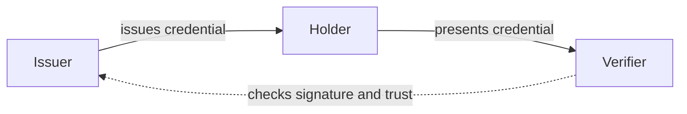

A verifiable credential is a set of claims about a subject, such as a name or a date of birth, signed by the party that makes the claims. Anyone who receives it can check that the claims came from that party and weren't changed. This page explains the model and the terms the rest of the docs use, and links to the section that covers each part.

## Issuer, holder and verifier

Three roles take part:

- The issuer signs a credential and gives it to the holder. A government issuing an ID or a university issuing a diploma are issuers.
- The holder keeps the credential in a wallet and decides when to share it.
- The verifier asks the holder for credentials and checks them.

The issuer doesn't take part when the holder presents a credential. The verifier only needs the issuer's public key, which it gets from a DID or an X.509 certificate (see [Trust](#trust)).

A Credo agent can take any of these roles, and one agent can take more than one. Usually issuers and verifiers run on a server with Node.js and holders run in a mobile wallet with React Native.

## Credentials and presentations

The issuer creates a credential. When the holder shares it, they create a presentation: the credential, or the parts of it the verifier asked for, plus proof that the holder is the one it was issued to. A presentation is bound to the verifier's request, usually through a nonce, so it can't be replayed to another verifier.

## Exchange protocols and credential formats

Credo separates two things:

- An exchange protocol defines how the parties talk: how an issuer offers a credential, how a wallet requests it, how a verifier asks for a presentation. Credo supports [OpenID4VC](../protocols/openid4vc/index.mdx) (OpenID4VCI for issuance, OpenID4VP for presentation) and [DIDComm](../protocols/didcomm/index.mdx) (Issue Credential and Present Proof).
- A credential format defines what a credential looks like and how it's signed: [SD-JWT VC](../credential-formats/sd-jwt-vc.mdx), [mdoc](../credential-formats/mdoc.mdx), [W3C Verifiable Credentials](../credential-formats/w3c-vc.mdx) and [AnonCreds](../credential-formats/anoncreds.mdx).

Several formats work over more than one protocol, and you can sign, store and verify a credential without any protocol. That's why the docs are split the same way: [Protocols](../protocols/index.mdx) covers the flows, [Credential formats](../credential-formats/index.mdx) covers what you can do with a format on its own, and pages such as [SD-JWT VC with OpenID4VC](../protocols/openid4vc/sd-jwt-vc.mdx) combine the two.

| Format | OpenID4VC | DIDComm |
| --- | --- | --- |
| SD-JWT VC | Yes | No |
| mdoc | Yes | No |
| W3C VC | Yes | Yes |
| AnonCreds | No | Yes |

Not every W3C data model and signature type works over both protocols. See [W3C Verifiable Credentials](../credential-formats/w3c-vc.mdx).

## Key binding

Most credentials are bound to a key that the holder controls. The issuer puts the holder's public key (or a DID that resolves to it) in the credential, and the holder signs each presentation with the private key. Someone who copies the credential can't present it without that key. AnonCreds binds credentials to a link secret instead of a key.

In Credo the holder's keys live in a key management service (KMS). See [Key management](../agent-setup/key-management.mdx).

## Selective disclosure

Selective disclosure lets the holder share some claims of a credential and keep the rest private:

- SD-JWT VC and mdoc: the issuer signs a salted hash of each claim, and the holder reveals only the claims the verifier asks for.
- AnonCreds: the holder creates a zero-knowledge proof, which can also prove a predicate, such as being over 18, without revealing the date of birth.
- W3C VCs: those secured with SD-JWT (data model 2.0) work like SD-JWT VC. Those signed as a plain JWT or with a Linked Data proof are always shared as a whole.

## Revocation and status

An issuer may need to revoke a credential, or suspend it for a while. With a status list, the issuer publishes a list with one entry per credential, and each credential points to its entry. The verifier fetches the list and checks the entry. Credo supports [Token Status Lists](../credential-formats/status-lists.mdx) for SD-JWT VC and mdoc. AnonCreds uses its own revocation registries, and the holder proves the credential isn't revoked as part of the presentation (see [AnonCreds](../credential-formats/anoncreds.mdx)).

## Trust

A valid signature only proves who signed a credential. The verifier still has to decide whether it trusts that issuer. Credo identifies issuers in two ways:

- [DIDs](../dids-and-trust/index.mdx): the issuer's key is published in a DID document, on a ledger, a web server, or in the DID itself. See [DIDs and DIDComm](./did-and-didcomm.md).
- [X.509 certificates](../dids-and-trust/x509.mdx): the issuer signs with a certificate that chains up to a root certificate the verifier trusts. mdoc always works this way, and SD-JWT VC often does.

You tell Credo which issuers to trust per verification, or with a callback on the agent. See [Trusted issuers](../dids-and-trust/trust.mdx).
