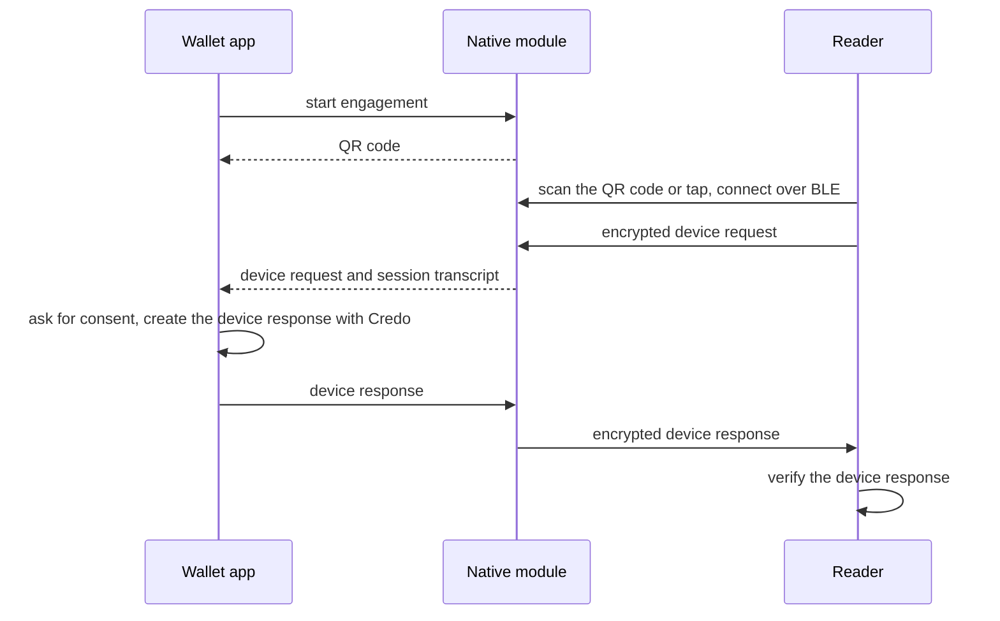

# Proximity (ISO 18013-5)

> Present mdocs in person over BLE after a QR code or NFC engagement from a React Native wallet with expo-mdoc-data-transfer and Credo, and verify the device response in a reader.

In a proximity presentation the wallet and the verifier's reader are in the same place, for example at a counter, and exchange the request and response over Bluetooth Low Energy (BLE) after the reader scans a QR code or taps the phone. A native module handles the engagement, the transport and the session encryption. Credo creates the device response in the wallet and verifies it in the reader. This page builds a screen for a React Native wallet that uses [`expo-mdoc-data-transfer`](https://github.com/openwallet-foundation-labs/expo-mdoc-data-transfer), then shows how a reader verifies the response. [ISO mdoc](https://credo.js.org/guides/next/protocols/mdoc.md) explains the messages.

[Paradym Wallet](https://github.com/animo/paradym-wallet), an open source wallet built on Credo, presents mdocs in person this way. See its [proximity code](https://github.com/animo/paradym-wallet/blob/main/apps/wallet/src/features/proximity/mdocProximity.ts).

## How it works



The module derives the session keys and the session transcript from the engagement, decrypts the request, and encrypts the response. Your app only handles the decrypted device request and the device response.

Credo doesn't decode device requests, so the wallet decodes them with `@owf/mdoc`, the mdoc library Credo builds on. Credo also doesn't check reader authentication on a proximity request, and only supports device signatures, not device MAC authentication.

## Wallet

### Set up

```bash
npm install expo-mdoc-data-transfer expo-build-properties @owf/mdoc@^0.8.2 react-native-qrcode-svg react-native-svg
```

Add the config plugins to `app.json` and run `npx expo prebuild`:

```json
{
  "expo": {
    "plugins": [
      "expo-mdoc-data-transfer",
      ["expo-build-properties", { "android": { "minSdkVersion": 26 }, "ios": { "useFrameworks": "dynamic" } }]
    ]
  }
}
```

- Use the `@owf/mdoc` version that `@credo-ts/core` depends on, so the app has one copy.
- The config plugin adds the Bluetooth and NFC permissions and the NFC engagement service to the Android manifest. See the [module README](https://github.com/openwallet-foundation-labs/expo-mdoc-data-transfer#readme).
- Dynamic frameworks on iOS change how every pod links. Paradym Wallet keeps some pods static, `askar` and `anoncreds` among them, with the plugin option `ios.buildStatic`.

Bluetooth and NFC don't work in emulators, so test on physical devices. Android also asks the user for the Bluetooth permissions at runtime:

:::holder

```ts
// Android 12 and later need the Bluetooth permissions, earlier versions the location permissions
async function requestBluetoothPermissions() {
  if (Platform.OS !== 'android') return

  const { PERMISSIONS } = PermissionsAndroid
  await PermissionsAndroid.requestMultiple(
    Platform.Version >= 31
      ? [PERMISSIONS.BLUETOOTH_ADVERTISE, PERMISSIONS.BLUETOOTH_CONNECT, PERMISSIONS.BLUETOOTH_SCAN]
      : [PERMISSIONS.ACCESS_FINE_LOCATION, PERMISSIONS.ACCESS_COARSE_LOCATION]
  )
}
```

:::

The wallet itself is an agent with storage and the stored mdocs, see [Your first agent](https://credo.js.org/guides/next/getting-started/first-agent.md). The screen below gets it as a prop.

### Engage and receive the request

When the user taps the button, the screen starts the engagement, shows the QR code and waits for the reader's request:

:::holder

```tsx
async function start() {
  await requestBluetoothPermissions()

  const transfer = mdocDataTransfer.instance()
  setQrCode(await transfer.startQrEngagement())
  // Also lets the reader engage with an NFC tap. Android only.
  transfer.enableNfc()

  // Resolves when a reader has scanned the QR code, connected over BLE and sent its request.
  // The module decrypts the request and derives the session transcript.
  const { deviceRequest, sessionTranscript } = await transfer.waitForDeviceRequest()
  setReaderRequest({ documentRequests: decodeDeviceRequest(deviceRequest), sessionTranscript })
}
```

:::

`startQrEngagement()` returns the device engagement to show as a QR code. On iOS, the reader always engages by scanning it. `waitForDeviceRequest()` resolves when a reader has connected and sent its request, and rejects when the transfer fails.

`decodeDeviceRequest` reads the requested data elements from the request:

:::holder

```ts
import {
  type Agent,
  CredentialMultiInstanceUseMode,
  isNonEmptyArray,
  type Mdoc,
  MdocDeviceResponse,
  type MdocDocumentRequest,
  TypedArrayEncoder,
  useInstanceFromCredentialRecord,
} from '@credo-ts/core'
import { DeviceRequest } from '@owf/mdoc'

// The requested data elements per document type, with the reader's intent to retain each one
export function decodeDeviceRequest(deviceRequest: Uint8Array): MdocDocumentRequest[] {
  return DeviceRequest.decode(deviceRequest).docRequests.map(({ itemsRequest }) => ({
    docType: itemsRequest.docType,
    nameSpaces: Object.fromEntries(
      Array.from(itemsRequest.namespaces, ([nameSpace, elements]) => [nameSpace, Object.fromEntries(elements)])
    ),
  }))
}
```

:::

`documentRequests` lists, per document type, the requested data elements and the reader's intent to retain each one. The screen shows them to the user before it shares anything.

### Create and send the device response

When the user agrees, the screen creates the device response and hands it to the module. `shutdown()` ends the session, and `useMdocDataTransferShutdownOnUnmount()` in the full example also does that when the user leaves the screen:

:::holder

```tsx
async function share(request: ReaderRequest) {
  const transfer = mdocDataTransfer.instance()
  // The module encrypts the response with the session keys and sends it
  await transfer.sendDeviceResponse(await createDeviceResponse(agent, request))
  stop()
}

function stop() {
  mdocDataTransfer.instance().shutdown()
  setQrCode(undefined)
  setReaderRequest(undefined)
}
```

:::

The device response itself is plain Credo:

:::holder

```ts
export async function createDeviceResponse(
  agent: Agent,
  options: { documentRequests: MdocDocumentRequest[]; sessionTranscript: Uint8Array }
) {
  const mdocs: Mdoc[] = []
  const documentRequests: MdocDocumentRequest[] = []

  for (const { docType, nameSpaces } of options.documentRequests) {
    const [record] = await agent.mdoc.findAllByQuery({ docType })
    if (!record) continue

    // A new instance for every presentation, if the mdoc was issued in a batch
    const { credentialInstance: mdoc } = await useInstanceFromCredentialRecord({
      agentContext: agent.context,
      credentialRecord: record,
      useMode: CredentialMultiInstanceUseMode.NewOrFirst,
    })

    // Disclose the requested elements the mdoc has. Requesting an element it doesn't have fails.
    const issuerSigned = mdoc.issuerSignedNamespaces
    const disclosed = Object.fromEntries(
      Object.entries(nameSpaces).map(([nameSpace, elements]) => [
        nameSpace,
        Object.fromEntries(Object.entries(elements).filter(([element]) => element in (issuerSigned[nameSpace] ?? {}))),
      ])
    )

    mdocs.push(mdoc)
    documentRequests.push({ docType, nameSpaces: disclosed })
  }

  if (!isNonEmptyArray(mdocs)) throw new Error('No mdoc of the requested document types')

  const deviceResponse = await MdocDeviceResponse.createDeviceResponse(agent.context, {
    mdocs,
    documentRequests,
    sessionTranscriptOptions: { type: 'sessionTranscriptBytes', sessionTranscriptBytes: options.sessionTranscript },
  })

  // The encoded DeviceResponse, for the transport to encrypt and send
  return deviceResponse.deviceResponse.encode()
}
```

:::

- `createDeviceResponse` throws when a requested element isn't in the mdoc, so the function only passes the elements the mdoc has. The reader sees the others as missing.
- `useInstanceFromCredentialRecord` takes a new instance of an mdoc issued in a batch, so readers can't link presentations. When no new instance is left, it reuses the first one.

The session transcript from the module goes in as `sessionTranscriptBytes`, and the device key of the mdoc signs over it. The module encrypts the returned `DeviceResponse` with the session keys.

## Reader

Credo doesn't implement the reader side of the transport, and `expo-mdoc-data-transfer` only covers the wallet. When your reader app has the device response and the session transcript from its own transport, Credo verifies the response:

:::verifier

```ts
export async function verifyDeviceResponse(
  agent: Agent,
  options: { deviceResponse: Uint8Array; sessionTranscript: Uint8Array; trustedCertificates: string[] }
) {
  const deviceResponse = MdocDeviceResponse.fromBase64Url(TypedArrayEncoder.toBase64Url(options.deviceResponse))

  // Throws when the response is invalid. Doesn't use the agent's trust configuration.
  await deviceResponse.verify(agent.context, {
    trustedCertificates: options.trustedCertificates,
    sessionTranscriptOptions: { type: 'sessionTranscriptBytes', sessionTranscriptBytes: options.sessionTranscript },
  })

  return deviceResponse.issuerClaims
}
```

:::

- `verify` doesn't use the agent's trust configuration. Pass the certificates of the issuers you trust, usually the IACA root certificates, as `trustedCertificates`, or every response fails.
- `verify` throws when the response is invalid. It checks the issuer signature and certificate chain, the element digests, the device signature over the session transcript, the validity period and the status. It doesn't check that the response contains what you asked for, so check `issuerClaims` (per document type and namespace) yourself.

## Full example

The wallet screen, and the Credo functions it and the reader use. Render `PresentInPersonScreen` with the wallet's agent.

**mdoc-proximity-wallet.tsx**

```tsx
// A screen of a React Native wallet that presents mdocs to a reader in person. expo-mdoc-data-transfer
// handles the engagement and the transport, Credo the device response (mdoc-proximity.ts).

import type { Agent, MdocDocumentRequest } from '@credo-ts/core'
import { mdocDataTransfer, useMdocDataTransferShutdownOnUnmount } from 'expo-mdoc-data-transfer'
import { useState } from 'react'
import { Button, PermissionsAndroid, Platform, Text, View } from 'react-native'
import QRCode from 'react-native-qrcode-svg'
import { createDeviceResponse, decodeDeviceRequest } from './mdoc-proximity.js'

interface ReaderRequest {
  documentRequests: MdocDocumentRequest[]
  sessionTranscript: Uint8Array
}

export function PresentInPersonScreen({ agent }: { agent: Agent }) {
  const [qrCode, setQrCode] = useState<string>()
  const [readerRequest, setReaderRequest] = useState<ReaderRequest>()

  // Ends the session when the user leaves the screen
  useMdocDataTransferShutdownOnUnmount()

  async function start() {
    await requestBluetoothPermissions()

    const transfer = mdocDataTransfer.instance()
    setQrCode(await transfer.startQrEngagement())
    // Also lets the reader engage with an NFC tap. Android only.
    transfer.enableNfc()

    // Resolves when a reader has scanned the QR code, connected over BLE and sent its request.
    // The module decrypts the request and derives the session transcript.
    const { deviceRequest, sessionTranscript } = await transfer.waitForDeviceRequest()
    setReaderRequest({ documentRequests: decodeDeviceRequest(deviceRequest), sessionTranscript })
  }

  async function share(request: ReaderRequest) {
    const transfer = mdocDataTransfer.instance()
    // The module encrypts the response with the session keys and sends it
    await transfer.sendDeviceResponse(await createDeviceResponse(agent, request))
    stop()
  }

  function stop() {
    mdocDataTransfer.instance().shutdown()
    setQrCode(undefined)
    setReaderRequest(undefined)
  }

  if (readerRequest) {
    return (
      <View style={{ gap: 16, padding: 24 }}>
        <Text>The reader asks for:</Text>
        {readerRequest.documentRequests.map(({ docType, nameSpaces }) => (
          <Text key={docType}>
            {docType}: {Object.values(nameSpaces).flatMap(Object.keys).join(', ')}
          </Text>
        ))}
        <Button title="Share" onPress={() => share(readerRequest)} />
        <Button title="Decline" onPress={stop} />
      </View>
    )
  }

  return (
    <View style={{ alignItems: 'center', gap: 16, padding: 24 }}>
      {qrCode ? <QRCode value={qrCode} size={250} /> : <Button title="Show QR code" onPress={start} />}
    </View>
  )
}

// Android 12 and later need the Bluetooth permissions, earlier versions the location permissions
async function requestBluetoothPermissions() {
  if (Platform.OS !== 'android') return

  const { PERMISSIONS } = PermissionsAndroid
  await PermissionsAndroid.requestMultiple(
    Platform.Version >= 31
      ? [PERMISSIONS.BLUETOOTH_ADVERTISE, PERMISSIONS.BLUETOOTH_CONNECT, PERMISSIONS.BLUETOOTH_SCAN]
      : [PERMISSIONS.ACCESS_FINE_LOCATION, PERMISSIONS.ACCESS_COARSE_LOCATION]
  )
}
```

**mdoc-proximity.ts**

```ts
import {
  type Agent,
  CredentialMultiInstanceUseMode,
  isNonEmptyArray,
  type Mdoc,
  MdocDeviceResponse,
  type MdocDocumentRequest,
  TypedArrayEncoder,
  useInstanceFromCredentialRecord,
} from '@credo-ts/core'
import { DeviceRequest } from '@owf/mdoc'

// The requested data elements per document type, with the reader's intent to retain each one
export function decodeDeviceRequest(deviceRequest: Uint8Array): MdocDocumentRequest[] {
  return DeviceRequest.decode(deviceRequest).docRequests.map(({ itemsRequest }) => ({
    docType: itemsRequest.docType,
    nameSpaces: Object.fromEntries(
      Array.from(itemsRequest.namespaces, ([nameSpace, elements]) => [nameSpace, Object.fromEntries(elements)])
    ),
  }))
}

export async function createDeviceResponse(
  agent: Agent,
  options: { documentRequests: MdocDocumentRequest[]; sessionTranscript: Uint8Array }
) {
  const mdocs: Mdoc[] = []
  const documentRequests: MdocDocumentRequest[] = []

  for (const { docType, nameSpaces } of options.documentRequests) {
    const [record] = await agent.mdoc.findAllByQuery({ docType })
    if (!record) continue

    // A new instance for every presentation, if the mdoc was issued in a batch
    const { credentialInstance: mdoc } = await useInstanceFromCredentialRecord({
      agentContext: agent.context,
      credentialRecord: record,
      useMode: CredentialMultiInstanceUseMode.NewOrFirst,
    })

    // Disclose the requested elements the mdoc has. Requesting an element it doesn't have fails.
    const issuerSigned = mdoc.issuerSignedNamespaces
    const disclosed = Object.fromEntries(
      Object.entries(nameSpaces).map(([nameSpace, elements]) => [
        nameSpace,
        Object.fromEntries(Object.entries(elements).filter(([element]) => element in (issuerSigned[nameSpace] ?? {}))),
      ])
    )

    mdocs.push(mdoc)
    documentRequests.push({ docType, nameSpaces: disclosed })
  }

  if (!isNonEmptyArray(mdocs)) throw new Error('No mdoc of the requested document types')

  const deviceResponse = await MdocDeviceResponse.createDeviceResponse(agent.context, {
    mdocs,
    documentRequests,
    sessionTranscriptOptions: { type: 'sessionTranscriptBytes', sessionTranscriptBytes: options.sessionTranscript },
  })

  // The encoded DeviceResponse, for the transport to encrypt and send
  return deviceResponse.deviceResponse.encode()
}

export async function verifyDeviceResponse(
  agent: Agent,
  options: { deviceResponse: Uint8Array; sessionTranscript: Uint8Array; trustedCertificates: string[] }
) {
  const deviceResponse = MdocDeviceResponse.fromBase64Url(TypedArrayEncoder.toBase64Url(options.deviceResponse))

  // Throws when the response is invalid. Doesn't use the agent's trust configuration.
  await deviceResponse.verify(agent.context, {
    trustedCertificates: options.trustedCertificates,
    sessionTranscriptOptions: { type: 'sessionTranscriptBytes', sessionTranscriptBytes: options.sessionTranscript },
  })

  return deviceResponse.issuerClaims
}
```

## Next steps

- [Digital Credentials API](https://credo.js.org/guides/next/protocols/dc-api.md): request mdocs from a website.
- [mdoc](https://credo.js.org/guides/next/credential-formats/mdoc.md): signing, storing and verifying mdocs.
- [Trusted issuers](https://credo.js.org/guides/next/dids-and-trust/trust.md): decide which issuers you trust.
