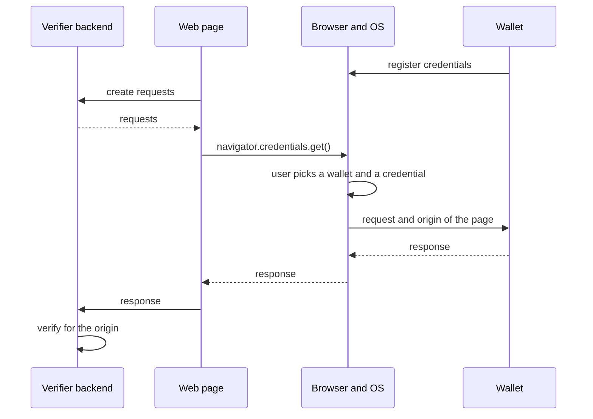

The W3C Digital Credentials API lets a website request credentials through the browser. The browser and the operating system let the user pick a wallet and a credential, on the same device or on a phone nearby, without QR codes or redirects. The API only carries the request and the response, and another protocol defines what they contain. Credo supports two, OpenID4VP and ISO 18013-7 Annex C, on both the verifier and the wallet side.

This page explains how the API works and what to choose. To build one side, see [Building a verifier](./verifier.mdx) or [Building a wallet](./wallet.mdx).

## How it works

The wallet registers its credentials with the operating system beforehand, so the browser only offers wallets that hold a matching credential. The verifier's backend creates the request with Credo, and its web page passes it to `navigator.credentials.get()`. The page can pass several requests in one call, one per protocol, and the wallet answers one of them.

The browser tells the wallet the origin of the page that asked. The wallet binds its response to that origin, and the backend verifies the response for its own origin, so a response can't be relayed to another website. Nothing goes over the network between the wallet and the verifier: the response comes back through the page.

## Protocols

| | OpenID4VP | ISO 18013-7 Annex C |
| --- | --- | --- |
| Protocol identifier | `openid4vp-v1-unsigned` or `openid4vp-v1-signed` | `org-iso-mdoc` |
| Credential formats | SD-JWT VC and mdoc | mdoc |
| Request | A DCQL query, which can express alternatives | A device request: document types and data elements |
| Verifier identity | The origin, or a signed request | The origin, or reader authentication |
| Response encryption | With response mode `dc_api.jwt` | Always |
| Platforms | Android | Android and iOS |
| Credo API | `agent.openid4vc` in `@credo-ts/openid4vc` | `agent.mdoc` in `@credo-ts/core` |

[OpenID4VC](../openid4vc/index.mdx) and [ISO mdoc](../mdoc/index.mdx) explain the protocols themselves.

## Platform support

Which browsers support the API, and which protocols they accept, differs per platform and changes quickly. Check the current support before you depend on it. At the time of writing:

| Platform | Protocols | How wallets take part |
| --- | --- | --- |
| Android | OpenID4VP and `org-iso-mdoc` | The wallet registers its credentials, with their claim values, in Credential Manager. A matcher compares each request with them in a sandbox, and the system picker shows the matching credentials. |
| iOS 26 and later | `org-iso-mdoc` only | The wallet is a document provider of the Identity Document Services framework. It registers only mdocs of a fixed set of document types, such as the mDL and the EU PID, and iOS matches requests on the document type alone. |

Chrome supports both protocols, and Safari only `org-iso-mdoc`. On desktop, the browser can pass the request to a phone nearby.

## Which should I use?

As a verifier:

| Choice | Default | When to pick the other |
| --- | --- | --- |
| Protocol | For mdocs, pass an OpenID4VP and an `org-iso-mdoc` request in one call, so wallets on both platforms can answer. For SD-JWT VCs, OpenID4VP. | `org-iso-mdoc` alone reaches wallets on both platforms without the OpenID4VC module, but misses Android wallets that only support OpenID4VP. |
| Signed requests | Unsigned. The wallet identifies you by the origin of your website, which the browser verified through its TLS certificate. | Sign when wallets or your ecosystem need to know who you are beyond the origin, for example a registered verifier. Use `x509_hash` for OpenID4VP, as HAIP does, and reader authentication for `org-iso-mdoc`. Some wallets only answer signed requests. |
| Response encryption (OpenID4VP) | `dc_api.jwt`. Only your backend can read the response, not the page and the browser it passes through. HAIP requires it. | `dc_api` only for testing. `org-iso-mdoc` always encrypts. |

As a wallet, support `org-iso-mdoc` for mdocs, as it's the only protocol iOS passes on, and OpenID4VP on Android for SD-JWT VCs and for verifiers that only send OpenID4VP. Credo answers signed and unsigned requests of both protocols, encrypted or not. HAIP also asks wallets to accept multi-signed OpenID4VP requests (`openid4vp-v1-multisigned`), which Credo doesn't support.

## Next steps

- [Building a verifier](./verifier.mdx): create the requests, call the API from a web page, and verify the response.
- [Building a wallet](./wallet.mdx): answer requests in a React Native wallet.
