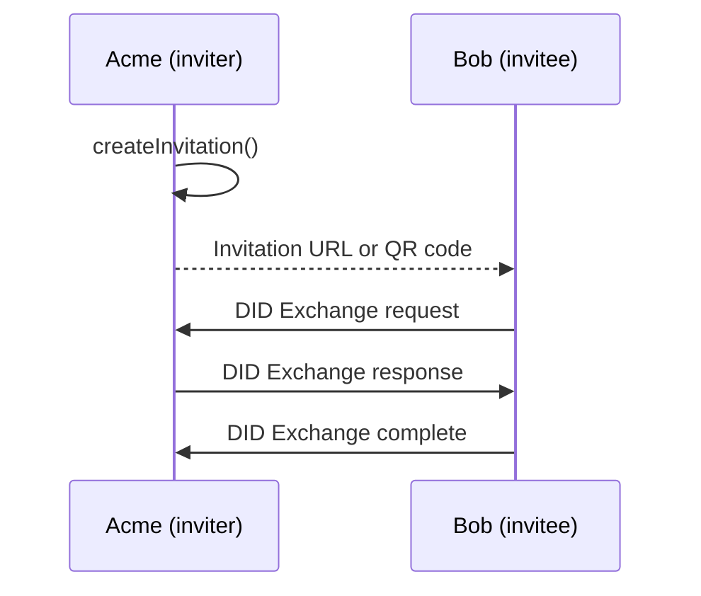

A DIDComm connection links two agents through a pair of DIDs, one for each side. Most DIDComm protocols run over a connection. This page covers invitations, connection states and events, and reusing connections.

## How a connection is made

One agent, the inviter, creates an [out-of-band invitation](https://github.com/hyperledger/aries-rfcs/tree/main/features/0434-outofband) and shares it as a URL or QR code. The other agent, the invitee, receives it and runs the [DID Exchange](https://github.com/hyperledger/aries-rfcs/tree/main/features/0023-did-exchange) protocol with the inviter.



The examples on this page run Acme and Bob as two Node.js agents that reach each other over HTTP:

```ts showLineNumbers title="connections.ts" didcomm-connections.ts section-1
```

With `autoAcceptConnections: true`, the inviter accepts DID Exchange requests automatically. On the invitee side, receiving an invitation accepts it by default. [Accept requests manually](#accept-requests-manually) shows how to approve each request yourself.

## Which invitation should I use?

| Invitation | Use it when |
| --- | --- |
| [Out-of-band invitation](#create-an-invitation) | You show a link or QR code to one user, for example during a web session. This is the default. |
| [Multi-use invitation](#multi-use-invitations) | You print or publish one QR code for everyone. Each invitee gets its own connection. |
| Connectionless, with `handshake: false` and `messages` | You only want to issue one credential or request one proof, without keeping a connection. See [Issuing credentials](./issue-credential.mdx#offer-a-credential) and [Requesting proofs](./present-proof.mdx#request-a-proof). |
| [Invitation with a public DID](#reuse-a-connection) | Returning users should reuse their existing connection instead of creating a new one. |
| [Implicit invitation](#implicit-invitations) | The invitee already knows your public DID and connects without an invitation. You accept each request manually. |

Whatever the invitation, each side of the connection uses a new `did:peer` that only the other party knows, so connections with different parties can't be linked. A public DID, such as a `did:web`, only identifies the inviter in the invitation. You need one only to reuse connections or to accept implicit invitations.

## Create an invitation

```ts showLineNumbers title="acme.ts" didcomm-connections.ts section-2
```

`toUrl()` encodes the invitation in the `oob` query parameter of the URL you pass as `domain`. Use a domain you control. Render the URL as a QR code with any QR code library.

Long invitations make dense QR codes. You can also share a short URL: when an invitation URL has no `oob` parameter, Credo fetches it and accepts either a JSON response with the invitation, or a redirect to the full invitation URL.

`createInvitation()` options you may need:

| Option | Description |
| --- | --- |
| `label` | Name shown to the invitee. |
| `alias` | Name for the connection in your own records. |
| `imageUrl` | Image shown to the invitee. |
| `goalCode`, `goal` | What the connection is for. |
| `multiUseInvitation` | Let more than one agent use the invitation. See [Multi-use invitations](#multi-use-invitations). |
| `autoAcceptConnection` | Override `autoAcceptConnections` for this invitation. |
| `messages` | Attach a message, such as a credential offer or proof request, to the invitation. See [Issuing credentials](./issue-credential.mdx) and [Requesting proofs](./present-proof.mdx). |
| `handshake` | Set to `false` to only send the attached `messages`, without creating a connection. |
| `invitationDid` | Use an existing DID instead of a new key in the invitation. See [Reuse a connection](#reuse-a-connection). |
| `routing` | Route the connection through a specific mediator. See [Mediation](./mediation.mdx). |

## Receive an invitation

```ts showLineNumbers title="bob.ts" didcomm-connections.ts section-4
```

`parseInvitation()` decodes the URL so you can show the invitation to the user before accepting it. `receiveInvitation()` then starts DID Exchange. To do both in one call, use `receiveInvitationFromUrl(url, config)`.

Credo only supports DID Exchange. An invitation that only offers the older Connection protocol (`https://didcomm.org/connections/1.0`) can't be accepted.

`label` is required: it is the name the inviter sees for you. Other options:

| Option | Default | Description |
| --- | --- | --- |
| `alias` | | Name for the connection in your own records. |
| `autoAcceptInvitation` | `true` | Start DID Exchange right away. If `false`, call `agent.didcomm.oob.acceptInvitation(outOfBandRecord.id, { label })` later. |
| `autoAcceptConnection` | `true` | Complete the connection when the response arrives. If `false`, call `agent.didcomm.connections.acceptResponse(connectionId)`. |
| `reuseConnection` | `false` | Use an existing connection with the inviter if there is one. See [Reuse a connection](#reuse-a-connection). |
| `routing` | default mediator | Route the connection through a specific mediator. |

`returnWhenIsConnected()` waits until the connection reaches the `completed` state, for up to 20 seconds unless you pass `{ timeoutMs }`.

Credo parses `oob` invitation URLs and legacy connectionless `d_m` URLs. It doesn't parse `c_i` URLs from the RFC 0160 Connections protocol. An agent can't receive the same invitation twice: the second attempt throws.

## Connection states and events

Each connection is a `DidCommConnectionRecord` with a `state` from `DidCommDidExchangeState`:

| State | Side | Meaning |
| --- | --- | --- |
| `invitation-received` | Invitee | Connection created, request not sent yet. |
| `request-sent` | Invitee | Waiting for the inviter's response. |
| `request-received` | Inviter | Waiting for you to accept the request, unless auto-accept is on. |
| `response-sent` | Inviter | Response sent, waiting for the invitee to complete. |
| `response-received` | Invitee | Waiting for you to accept the response, unless auto-accept is on. |
| `completed` | Both | The connection is ready. |

The inviter has no connection record until the first request arrives. Listen for connection state changes and filter on the out-of-band record to react to connections from a specific invitation:

```ts showLineNumbers title="acme.ts" didcomm-connections.ts section-3
```

To look up the connections an invitation created, use `findAllByOutOfBandId()`:

```ts showLineNumbers title="acme.ts" didcomm-connections.ts section-5
```

The out-of-band record has its own state (`DidCommOutOfBandState`: `initial`, `await-response`, `prepare-response`, `done`) and emits `DidCommOutOfBandEventTypes.OutOfBandStateChanged`.

## Accept requests manually

Create the invitation with `autoAcceptConnection: false`, or leave `autoAcceptConnections` off in the module config. Then accept each request when it arrives:

```ts showLineNumbers title="acme.ts" didcomm-connections-public-did.ts section-4
```

Requests from [implicit invitations](#implicit-invitations) always need this step.

## Multi-use invitations

A regular invitation creates one connection. A multi-use invitation stays valid, and every agent that uses it gets its own connection. Use it for invitations you print or publish, like a QR code on a website.

```ts showLineNumbers title="acme.ts" didcomm-connections.ts section-6
```

After Carol and Dave each receive the invitation:

```ts showLineNumbers title="acme.ts" didcomm-connections.ts section-7
```

You can't attach `messages` to a multi-use invitation.

## Reuse a connection

When an inviter puts the same DID in all of its invitations, an invitee that is already connected can reuse that connection instead of creating a new one. The inviter sets `invitationDid`, usually a public DID with a DIDComm service in its DID document (see [DIDs](../../dids-and-trust/index.mdx)):

```ts showLineNumbers title="acme.ts" didcomm-connections-public-did.ts section-1
```

The invitee passes `reuseConnection: true`. If it has a connection with that DID, Credo sends a handshake reuse message over it and returns the existing connection:

```ts showLineNumbers title="bob.ts" didcomm-connections-public-did.ts section-3
```

The inviter learns about the reuse through an event:

```ts showLineNumbers title="acme.ts" didcomm-connections-public-did.ts section-2
```

Invitations without `invitationDid` contain a new key each time, so Credo never matches them to an existing connection.

## Implicit invitations

If you know an agent's public DID, you can connect without an invitation. Credo builds the invitation from the DIDComm services in the DID document:

```ts showLineNumbers title="bob.ts" didcomm-connections-public-did.ts section-5
```

`did` can also be a DID URL that points to one service, for example `did:web:acme.example.com#didcomm`. The inviter must have created the DID in its own agent, and it [accepts the request manually](#accept-requests-manually): Credo never accepts requests from implicit invitations automatically.

## Manage connections

| Method on `agent.didcomm.connections` | Description |
| --- | --- |
| `sendPing(connectionId)` | Send a trust ping to check that the other agent is reachable. |
| `rotate({ connectionId })` | Switch to a new DID for this connection and tell the other agent (DID Rotate). |
| `hangup({ connectionId, deleteAfterHangup })` | Tell the other agent the connection is over. With `deleteAfterHangup: true`, Credo also deletes the record. |
| `deleteById(connectionId)` | Delete the connection record without notifying the other agent. |
| `findAllByQuery(query)` | Find connections, for example by `state` or `theirDid`. |

## Next steps

<Cards>
  <Card to="protocols/didcomm/issue-credential" title="Issuing credentials">Issue a credential over a connection.</Card>
  <Card to="protocols/didcomm/present-proof" title="Requesting proofs">Request and verify a presentation.</Card>
  <Card to="protocols/didcomm/messaging" title="Messaging">Send basic messages and use other protocols.</Card>
  <Card to="protocols/didcomm/mediation" title="Mediation">Reach mobile agents through a mediator.</Card>
</Cards>
