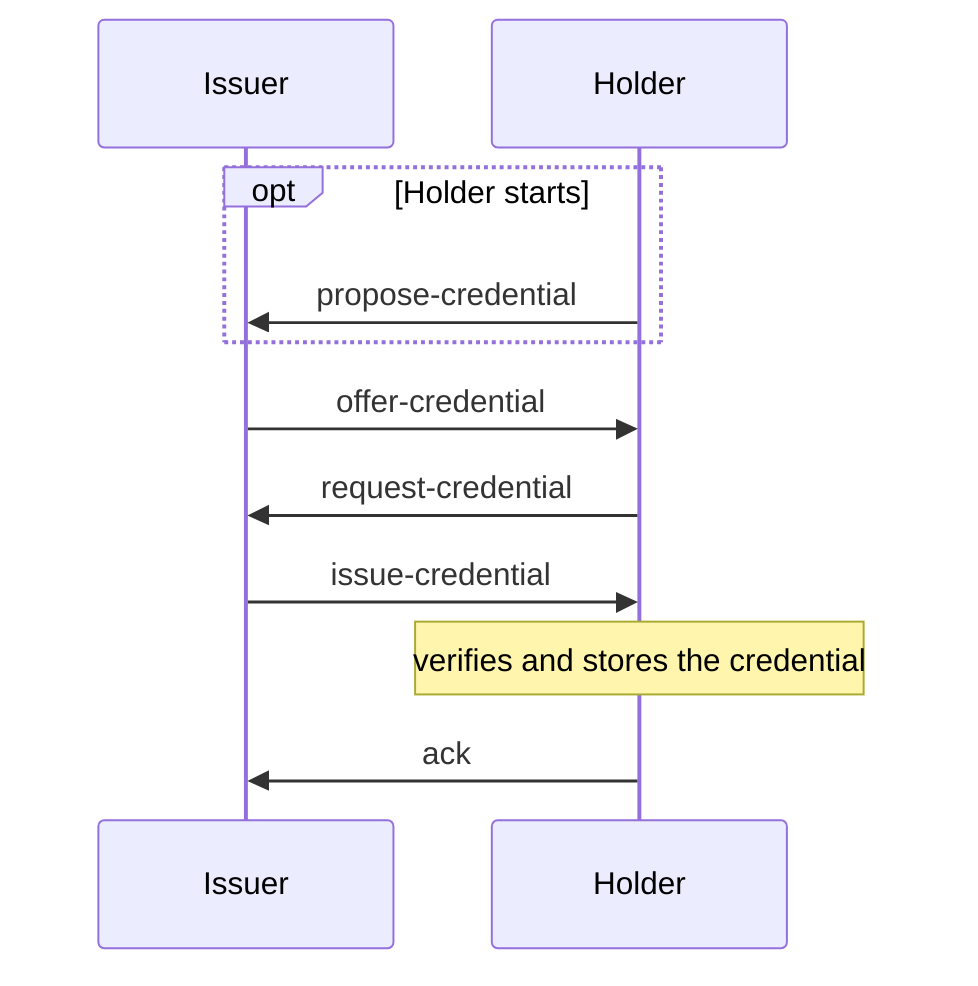

Issue Credential v2 ([Aries RFC 0453](https://github.com/decentralized-identity/aries-rfcs/tree/main/features/0453-issue-credential-v2)) exchanges a credential between two connected DIDComm agents. Format services plug the credential formats into the protocol. This page covers the protocol, with a W3C JSON-LD credential as the example. You need an agent with the DIDComm module and a connection to the other party, see [DIDComm](./index.mdx) and [Connections](./connections.mdx).

## Register credential formats

`DidCommModule` enables the credentials module by default, but its Issue Credential v2 protocol has no formats registered, so it can't issue or receive anything. Pass a `DidCommCredentialV2Protocol` with the format services you need. Both agents must register a format to exchange credentials in it.

```ts showLineNumbers title="agent.ts" didcomm-issue.ts section-1
```

| Format | Format service | Import from | Key |
| --- | --- | --- | --- |
| AnonCreds | `AnonCredsDidCommCredentialFormatService` | `@credo-ts/anoncreds/didcomm` | `anoncreds` |
| AnonCreds with Hyperledger Indy attachments | `LegacyIndyDidCommCredentialFormatService` | `@credo-ts/anoncreds/didcomm` | `indy` |
| W3C VCDM 1.1 JSON-LD ([RFC 0593](https://github.com/decentralized-identity/aries-rfcs/tree/main/features/0593-json-ld-cred-attach)) | `DidCommJsonLdCredentialFormatService` | `@credo-ts/didcomm` | `jsonld` |
| W3C VCDM 1.1 and 2.0 Data Integrity ([RFC 0809](https://github.com/decentralized-identity/aries-rfcs/tree/main/features/0809-w3c-data-integrity-credential-attachment)) | `DidCommDataIntegrityCredentialFormatService` | `@credo-ts/didcomm` | `dataIntegrity` |
| W3C VCDM 2.0 secured with SD-JWT, `vc+sd-jwt` ([RFC 0881](https://github.com/decentralized-identity/aries-rfcs/tree/main/features/0881-w3c-vc-sd-jwt-credential-attachment)) | `DidCommW3cV2SdJwtCredentialFormatService` | `@credo-ts/didcomm` | `w3cV2SdJwt` |

The key is the property name you use under `credentialFormats` in the API calls. The format-specific options are on [AnonCreds with DIDComm](./anoncreds.mdx) and [W3C VCs with DIDComm](./w3c.mdx).

Which format to use depends on the credentials your ecosystem uses and how holders present them:

- `anoncreds` for AnonCreds credentials, for example when verifiers need predicates such as "older than 18". Add `indy` only for agents that don't support `anoncreds` yet.
- `jsonld` for W3C credentials that holders present over DIDComm.
- `w3cV2SdJwt` and `dataIntegrity` with a VCDM 2.0 credential can't be presented over DIDComm. Use them only when holders present elsewhere, see [W3C VCs with DIDComm](./w3c.mdx).

There is no DIDComm format for SD-JWT VC, mdoc or W3C VCDM 1.1 JWT credentials. Issue those with [OpenID4VC](../openid4vc/index.mdx).

## How issuance works



Usually the issuer starts with an offer. The holder can also start with a proposal, and either side can answer with a counter-proposal or counter-offer (`negotiateOffer`, `negotiateProposal`). Each agent tracks the exchange in a `DidCommCredentialExchangeRecord`, and emits an event whenever its state changes.

## Offer a credential

:::issuer

```ts showLineNumbers title="issuer.ts" didcomm-issue.ts section-2
```

:::

`protocolVersion: 'v2'` selects Issue Credential v2, and `credentialFormats` holds the format data. Here the issuer is a `did:key` created in the issuer's agent, and `credentialSubject.id` is the holder's DID. [W3C VCs with DIDComm](./w3c.mdx) explains the JSON-LD options.

To offer a credential without an existing connection, create the offer with `createOffer` and attach the returned `message` to an out-of-band invitation with `agent.didcomm.oob.createInvitation({ messages: [message] })`. The holder then connects first and receives the offer over the new connection. Add `handshake: false` to run the exchange connectionless.

## Accept the offer

The holder listens for state changes. When an offer arrives, show it to the user, then accept it to send a credential request.

:::holder

```ts showLineNumbers title="holder.ts" didcomm-issue.ts section-3
```

:::

`getFormatData` returns the offer per format. `declineOffer` rejects it, and with `sendProblemReport: true` it tells the issuer. When the credential arrives, the format service verifies and stores it before the exchange completes. `credentialExchangeRecord.credentials` lists the stored records: `credentialRecordType` is `w3c` for W3C VCDM 1.1 and AnonCreds credentials, and `w3c-v2` for VCDM 2.0 SD-JWT credentials. [W3C VCs with DIDComm](./w3c.mdx) covers the exception for Data Integrity VCDM 2.0 credentials.

Deleting the exchange record with `agent.didcomm.credentials.deleteById` also deletes the stored credential, unless you pass `deleteAssociatedCredentials: false`.

## Start with a proposal

The holder proposes the credential it wants, in the same shape as an offer:

:::holder

```ts showLineNumbers title="holder.ts" didcomm-issue.ts section-4
```

:::

The issuer accepts the proposal, which sends an offer with the proposed content. To offer something else, call `negotiateProposal` instead.

:::issuer

```ts showLineNumbers title="issuer.ts" didcomm-issue.ts section-5
```

:::

With `ContentApproved` auto-accept on both sides, the rest of this exchange runs by itself: the offer matches the proposal, the request matches the offer, and the credential matches the request.

## Auto-accept

Set `autoAcceptCredentials` on the credentials module, or `autoAcceptCredential` on a single API call (it then applies to that exchange).

| `DidCommAutoAcceptCredential` | Behaviour |
| --- | --- |
| `Never` (default) | Every step needs an API call: `acceptOffer`, `acceptRequest`, `acceptCredential`, and so on. |
| `ContentApproved` | After one manual approval, Credo continues as long as each message matches the previous one. An offer that doesn't answer your own proposal always needs `acceptOffer`. |
| `Always` | Credo answers every message, including offers from any connection. |

For an issuer, `ContentApproved` is a good default: creating the offer is the approval, and Credo issues when the request matches it. Proposals still wait for `acceptProposal`. For a wallet, `ContentApproved` keeps the user in control: offers wait for `acceptOffer`, and Credo sends the ack when the credential arrives. Don't use `Always` on either side: an issuer would issue whatever a holder proposes, and a wallet would accept every offer.

## States and events

Listen to `DidCommCredentialEventTypes.DidCommCredentialStateChanged`. The payload has the `credentialExchangeRecord` and its `previousState`.

| `DidCommCredentialState` | Agent | Next step |
| --- | --- | --- |
| `ProposalSent` | holder | wait for the offer |
| `ProposalReceived` | issuer | `acceptProposal` or `negotiateProposal` |
| `OfferSent` | issuer | wait for the request |
| `OfferReceived` | holder | `acceptOffer`, `declineOffer` or `negotiateOffer` |
| `RequestSent` | holder | wait for the credential |
| `RequestReceived` | issuer | `acceptRequest` issues the credential |
| `CredentialIssued` | issuer | wait for the ack |
| `CredentialReceived` | holder | the credential is stored, `acceptCredential` sends the ack |
| `Done` | both | |
| `Declined` | holder | |
| `Abandoned` | both | the exchange failed, `errorMessage` says why |

Query exchanges with `agent.didcomm.credentials.findAllByQuery({ state, connectionId })`.
