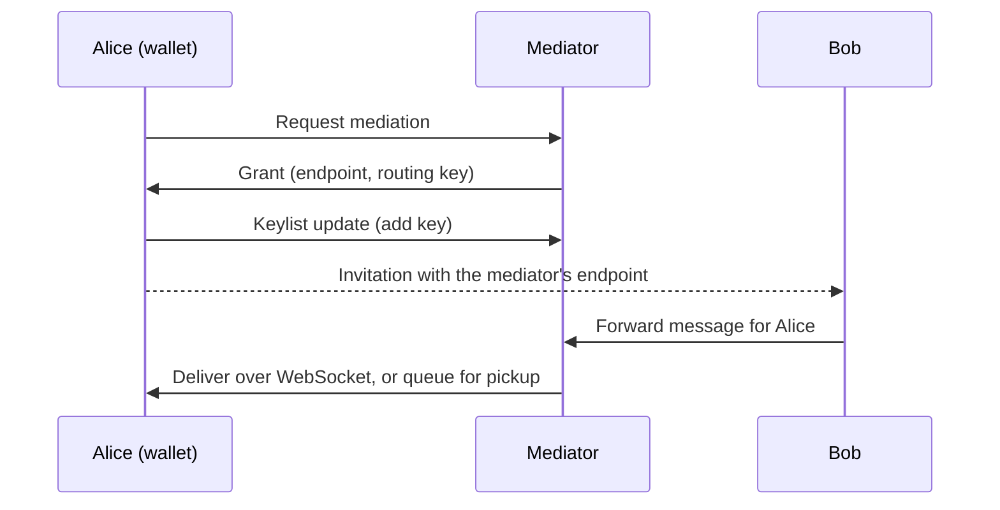

A mediator is an agent that receives messages on behalf of agents that can't be reached directly, and holds them until they are picked up. This page covers running a mediator, connecting an agent to it as a recipient, choosing a pickup strategy, and how routing keys stay in sync.

## When you need a mediator

An agent needs a mediator when other agents can't reach it. A mobile wallet always needs one when it uses DIDComm: a phone has no public address, and the app is often closed. A server agent with public `endpoints` doesn't need one.

A wallet with a mediator puts the mediator's endpoint and routing key in its invitations and DID documents. Senders wrap their messages in a forward message to the mediator, and the mediator delivers them to the wallet over a WebSocket, or queues them until the wallet picks them up.



Credo implements [Coordinate Mediation 1.0](https://github.com/hyperledger/aries-rfcs/tree/main/features/0211-route-coordination) and message pickup ([Pickup 1.0](https://github.com/hyperledger/aries-rfcs/tree/main/features/0212-pickup) and [2.0](https://github.com/hyperledger/aries-rfcs/tree/main/features/0685-pickup-v2)) for both roles. Messages from a wallet to other agents don't go through its mediator.

## Run a mediator

A mediator is a Node.js agent with the `mediator` protocol turned on. It needs an HTTP endpoint for senders and a WebSocket endpoint so wallets can receive messages live.

```ts showLineNumbers title="mediator.ts" didcomm-mediation.ts section-1
```

The mediator shares one multi-use invitation with all wallets. Without `autoAcceptMediationRequests`, listen for `DidCommRoutingEventTypes.MediationStateChanged` and grant requests in the `requested` state with `agent.didcomm.mediator.grantRequestedMediation(mediationRecordId)`.

| Option | Default | Description |
| --- | --- | --- |
| `mediator.autoAcceptMediationRequests` | `false` | Grant every mediation request. |
| `mediator.messageForwardingStrategy` | `DirectDelivery` | `DirectDelivery` sends a forwarded message right away over an open session with the recipient, and queues it if that isn't possible. `QueueOnly` always queues. `QueueAndLiveModeDelivery` queues, then delivers the queue to recipients in live mode. |
| `messagePickup.maximumBatchSize` | `10` | Maximum number of messages per pickup batch. |
| `queueTransportRepository` | in memory | Where queued messages are stored. Pass a persistent implementation in production, or messages are lost on restart. |

For production, look at [DIDComm Mediator Credo](https://github.com/openwallet-foundation/didcomm-mediator-credo), a mediator built on Credo with a persistent message queue and a Docker image.

## Connect to a mediator

On the recipient, set `mediatorInvitationUrl` in the `mediationRecipient` options:

<Tabs groupId="platform" queryString>
<TabItem value="node" label="Node.js">

```ts showLineNumbers title="wallet.ts" didcomm-mediation.ts section-2
```

</TabItem>
<TabItem value="react-native" label="React Native">

```ts showLineNumbers title="agent.ts" didcomm-setup-rn.ts section-1
```

</TabItem>
</Tabs>

`DidCommMediatorPickupStrategy` is exported from `@credo-ts/didcomm`. [Pickup strategies](#pickup-strategies) explains the options.

During `initialize()`, Credo connects to the mediator if it isn't connected yet, requests mediation, waits for the grant and sets the mediator as the default. Then it starts picking up messages. Startup therefore depends on the mediator being reachable. To keep startup independent, leave out `mediatorInvitationUrl` and connect later with the API:

| Method on `agent.didcomm.mediationRecipient` | Description |
| --- | --- |
| `provision(connection)` | Request mediation over a connection, wait for the grant, and set the mediator as default. |
| `initiateMessagePickup(mediator?, strategy?)` | Start picking up messages, from the default mediator unless you pass a mediation record. |
| `stopMessagePickup()` | Stop all message pickup. |
| `findDefaultMediator()` | Get the mediation record of the default mediator. |
| `setDefaultMediator(mediationRecord)` | Change the default mediator. |

Once a default mediator is set, new invitations and connections route through it without extra code:

```ts showLineNumbers title="wallet.ts" didcomm-mediation.ts section-4
```

To use another mediator for one connection, create routing with `agent.didcomm.mediationRecipient.getRouting({ mediatorId })` and pass it as `routing` to `createInvitation()` or `receiveInvitation()`.

## Pickup strategies

`mediatorPickupStrategy` decides how the recipient gets its messages:

| Strategy | How it works |
| --- | --- |
| `PickUpV2LiveMode` | Opens a WebSocket, picks up queued messages, then asks the mediator to push new messages as they arrive (Pickup 2.0 live mode). |
| `PickUpV2` | Polls with Pickup 2.0 every `mediatorPollingInterval` milliseconds. |
| `PickUpV1` | Polls with Pickup 1.0 every `mediatorPollingInterval` milliseconds. |
| `Implicit` | Opens a WebSocket and keeps it open, so the mediator can send messages over it. |
| `None` | Doesn't pick up messages automatically. |

For a mobile wallet, use `PickUpV2LiveMode`: messages arrive as soon as the mediator receives them, and Credo reopens the WebSocket when it drops. It needs a WebSocket endpoint on the mediator and `DidCommWsOutboundTransport` on the wallet. Use `PickUpV2` if the mediator has no WebSocket endpoint, and `Implicit` for mediators that don't support a pickup protocol.

Without a strategy, Credo asks the mediator which pickup protocols it supports and uses `PickUpV2`, `PickUpV1` or `Implicit`, in that order. It never chooses live mode on its own. Credo stores the choice on the mediation record, and the stored choice wins over `mediatorPickupStrategy` from then on, so set the strategy before the agent first connects to the mediator.

| Option | Default | Description |
| --- | --- | --- |
| `mediatorPollingInterval` | `5000` | Milliseconds between polls for `PickUpV1` and `PickUpV2`. |
| `maximumMessagePickup` | `10` | Messages per batch when polling. |
| `baseMediatorReconnectionIntervalMs` | `100` | First delay before reconnecting a closed WebSocket. It doubles after each attempt. |
| `maximumMediatorReconnectionIntervalMs` | no limit | Longest delay between reconnection attempts. |

## Control message pickup

A mobile app usually stops pickup when it goes to the background and starts it again when it returns:

```ts showLineNumbers title="wallet.ts" didcomm-mediation.ts section-5
```

If you'd rather decide when pickup runs, set `mediatorPickupStrategy: DidCommMediatorPickupStrategy.None` and pass the strategy when you start it: `initiateMessagePickup(undefined, DidCommMediatorPickupStrategy.PickUpV2LiveMode)`.

To fetch queued messages once, for example in a background task, use the message pickup API and wait until the messages are processed:

```ts showLineNumbers title="wallet.ts" didcomm-mediation.ts section-6
```

## Keylist updates

The mediator only forwards messages for keys in the recipient's keylist. Credo keeps the keylist up to date: every time it creates routing through a mediator, for a new invitation, connection or DID rotation, it adds the new key and waits for the mediator to confirm. Deleting a connection with `connections.deleteById()`, or with `connections.hangup({ connectionId, deleteAfterHangup: true })`, removes its keys again. After a DID rotation, `connections.removePreviousDids({ connectionId })` removes the old keys.

Each confirmed update emits an event:

```ts showLineNumbers title="wallet.ts" didcomm-mediation.ts section-3
```

For keys created outside of Credo's routing, send the update yourself with `agent.didcomm.mediationRecipient.notifyKeylistUpdate(connection, verkey, action)`.
