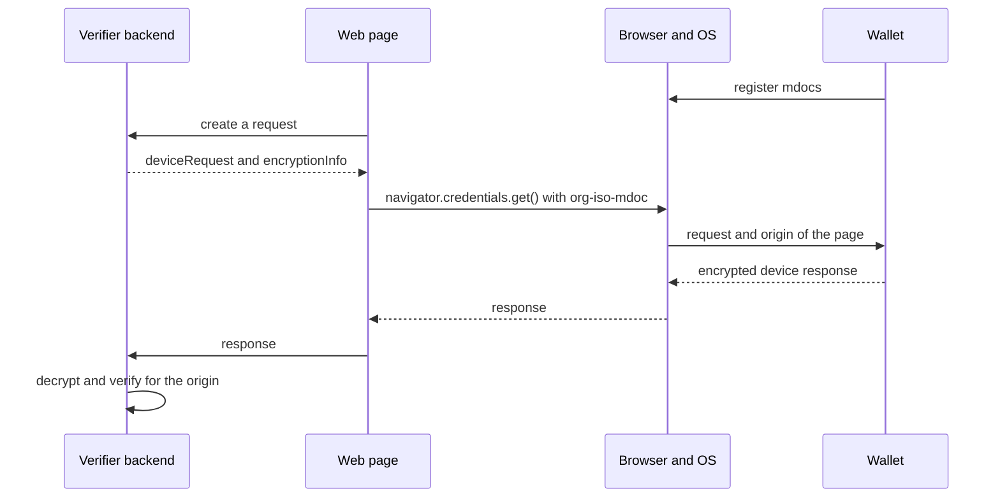

The W3C Digital Credentials API lets a website request credentials through the browser. The browser and the operating system let the user pick a wallet, on the same device or on a phone nearby. ISO/IEC TS 18013-7 Annex C defines `org-iso-mdoc`, a protocol to request mdocs over this API. Credo implements both the verifier and the wallet side in `agent.mdoc`, which is part of `@credo-ts/core`, so you don't need the OpenID4VC module. This page shows the three parts of a flow: the verifier backend, the browser invocation on the verifier's web page, and the wallet. To use OpenID4VP over the same API, see [Digital Credentials API](../openid4vc/dc-api.mdx) under OpenID4VC.

## How it works



The request has two parts. `deviceRequest` is the ISO 18013-5 device request with the data elements you ask for. `encryptionInfo` holds a nonce and a public key of the verifier, and the wallet encrypts its device response to that key with HPKE. The session transcript contains a hash of `encryptionInfo` and of the origin that the browser passes to the wallet. A response therefore only decrypts and verifies for the origin it was made for, so it can't be relayed from another website.

Annex C has no query language. You list the data elements you need, and the response must contain them. Platform support for the API differs and changes quickly, and some platforms, such as iOS, only accept `org-iso-mdoc`. A page can pass an OpenID4VP request and an `org-iso-mdoc` request in one call, and the wallet answers one of them.

## Verifier backend

The backend is a Node.js server with a Credo agent. `agent.mdoc` is available on every agent. The verifier needs storage for its verification sessions and a KMS for the session keys, here [Askar](../../agent-setup/storage/askar.mdx). The backend also serves the web page:

```ts showLineNumbers title="mdoc-dc-api.ts" mdoc-dc-api.ts section-1
```

- `origin` is the origin of the page that calls the API. Here the backend serves the page, so it's the backend's own origin.
- The verifier accepts mdocs from the issuers in its trust configuration. See [Trusted issuers](../../dids-and-trust/trust.mdx).

### Create the request

The verifier creates a verification session and returns the request to the page:

```ts showLineNumbers title="mdoc-dc-api.ts" mdoc-dc-api.ts section-2
```

- `nameSpaces` maps each requested data element to its intent to retain. Pass `{ intentToRetain, optional, source }` instead of a boolean to accept a response without the element (`optional: true`), or with the element signed by the device instead of the issuer (`source: 'deviceSigned'` or `'any'`). Only the intent to retain goes to the wallet.
- By default the response must contain every requested element, issuer signed. With several `docRequests`, set `treatAmbiguousMultipleDocRequestsAsAlternatives` if one of them is enough. The flag isn't part of the request, so the wallet may still answer all of them.
- Each session has its own encryption key in the KMS and expires after 5 minutes (`expiresInSeconds`).

To sign the document requests with your reader certificate, so the wallet can show who is asking, add `readerAuth`. Without it the wallet only knows the origin:

```ts
readerAuth: { certificate: readerCertificate, origin },
```

The signature covers one origin, so create a session per origin. The certificate's key must be in the verifier's KMS.

### Verify the response

```ts showLineNumbers title="mdoc-dc-api.ts" mdoc-dc-api.ts section-3
```

- `origin` is the origin of your page. Use the value you know, not one from the request: verification fails for any other origin. With `readerAuth`, it's the origin you signed for.
- Credo decrypts the response, verifies each mdoc (issuer signature and certificate chain, element digests, device signature, validity and status), and checks the response against the request. When an element is missing or isn't signed as required, it throws `MdocDeviceRequestNotSatisfiedError`, with the details in `deviceRequestMatch`.
- Pass `trustedCertificates` to set the trusted issuers for one call.
- `deviceResponse.issuerClaims` has the disclosed elements per document type and namespace. `deviceClaims` has the device-signed ones.
- A response for an expired session throws `MdocVerificationSessionExpiredError`. Create a new request.
- Credo doesn't delete sessions or their keys by itself. Delete sessions you're done with, including failed and expired ones, with `deleteVerificationSessionById`, which also deletes the key.

## Browser invocation

The web page gets a request from the backend, passes it to `navigator.credentials.get()`, and posts the response back:

```ts showLineNumbers title="mdoc-dc-api-browser.ts" mdoc-dc-api-browser.ts section-1
```

- `request` goes to the API as it is, as the `data` of an `org-iso-mdoc` request.
- TypeScript's DOM types don't have the `digital` option yet. The full example declares it.
- `credential.data` is the encrypted response of the wallet. Post it to your backend as it is.
- The call throws a `NotAllowedError` when the user cancels or no wallet has a matching mdoc. The browser doesn't say which, so a website can't find out what a wallet holds without the user's consent.

Call it when the user clicks a button:

```ts showLineNumbers title="mdoc-dc-api-browser.ts" mdoc-dc-api-browser.ts section-2
```

- The browser only opens the wallet shortly after a user action. A single request to your backend before the call is quick enough. For slower work, get the request before the click.
- The API only exists in a secure context (`https`, or `http://localhost`) and in browsers that support it.

## Wallet

The operating system passes the request and the origin of the page to the wallet the user picked, through Credential Manager on Android and the Identity Document Services framework on iOS. In a React Native wallet, [`@animo-id/expo-digital-credentials-api`](https://github.com/animo/expo-digital-credentials-api) handles the platform side on both, and Credo creates the response. This section shows a minimal wallet that answers both `org-iso-mdoc` and OpenID4VP requests. The [module README](https://github.com/animo/expo-digital-credentials-api#readme) has all options and platform details.

[Paradym Wallet](https://github.com/animo/paradym-wallet), an open source wallet built on Credo, supports the API this way. See its [request handling](https://github.com/animo/paradym-wallet/blob/main/packages/sdk/src/dcApi/ParadymDcApiSdk.ts), [credential registration](https://github.com/animo/paradym-wallet/blob/main/packages/sdk/src/dcApi/registerCredentials.ts) and [request UI](https://github.com/animo/paradym-wallet/tree/main/apps/wallet/src/features/dc-api) for a complete implementation.

### Set up

<InstallTabs packages="@animo-id/expo-digital-credentials-api expo-secure-store" />

Add the config plugin to `app.json` and run `npx expo prebuild`:

```json title="app.json"
{
  "expo": {
    "plugins": [
      [
        "@animo-id/expo-digital-credentials-api",
        {
          "entry": "src/dc-api-wallet-request",
          "ios": { "documentTypes": ["org.iso.18013.5.1.mDL"] }
        }
      ]
    ]
  }
}
```

- The module needs Expo SDK 55 and React Native 0.83 or later. It works on Android devices with Credential Manager's registry API, and on iOS 26 and later.
- `entry` is the file with the request UI, without extension.
- `ios.documentTypes` are the mdoc document types the wallet can present on iOS, from the set Apple allows. Without it, the plugin doesn't add the iOS app extension.

The app and the request UI open the same wallet:

```ts showLineNumbers title="dc-api-wallet-agent.ts" dc-api-wallet-agent.ts section-1
```

- On iOS, the request UI runs in an app extension, a separate process that can't read the app's files. The config plugin creates an app group, and `getSharedContainerPath()` returns a directory that both can use. A wallet that already has a store elsewhere has to move it there first.
- The plugin also shares the keychain between the app and the extension, so both read the same wallet key.

### Register mdocs

The operating system only offers the wallet for a request that matches a registered credential:

```ts showLineNumbers title="dc-api-wallet-agent.ts" dc-api-wallet-agent.ts section-2
```

- On Android, a matcher runs in a sandbox and compares the request with the registered data elements. The system picker shows the matching mdocs with their values, so register the values: the full example converts them.
- On Android each call replaces the registered set, so pass all credentials.
- iOS only keeps the id and document type of each mdoc, and only for the document types in `ios.documentTypes`. It matches on the document type, so a request can reach the wallet for elements the mdoc doesn't have.

### Answer the request

When the user picks an mdoc of the wallet, the operating system starts the request UI. Credo resolves the request for the origin and creates the encrypted response:

```ts showLineNumbers title="dc-api-wallet-response.ts" dc-api-wallet-response.ts section-2
```

- `resolveDcApiRequest` needs the origin, and rejects a request without one. It verifies reader authentication and matches the stored mdocs against each document request.
- A signed request from a reader you don't trust throws. Trust readers through the agent's trust configuration with verification type `mdocReaderAuth`, or pass `trustedReaderCertificates`. `readerAuth.certificateChain` on each document request has the verified chain, leaf first, to show the verifier to the user.
- `success` is `false` when the stored mdocs can't satisfy the request. `validCredentials` lists the matching mdocs per document request.
- `createDcApiResponse` discloses every requested element. Pass `elements` per credential to disclose fewer, for example to leave out the ones the user declined.
- It sends nothing. Hand the returned `response` back to the platform.

The request UI calls it when the user shares:

```tsx showLineNumbers title="dc-api-wallet-request.tsx" dc-api-wallet-request.tsx section-1
```

- Always use the origin from the operating system, never one from the request. On Android it's undefined when an app asks for itself instead of a website.
- On Android, `requests` has the requests the page passed, and `selection` the credentials the user picked in the system picker and the request they matched.
- iOS has no picker, and hands over the request only after `approve()`. Before that, `request.presentmentRequests` has the document types and elements the operating system parsed from it, to show on the consent screen.
- `respond()` sends the response through the operating system to the page, `decline()` cancels. Until then the request stays open, so the user can try again after an error.

The entry file registers the screen:

```tsx title="dc-api-wallet-request.tsx" dc-api-wallet-request.tsx section-2
```

The request UI is bundled separately from the app. Import only what it needs: on iOS the extension gets little memory.

## Full example

The verifier backend serves the page from `public/`. Put the certificate of the issuer you trust in `issuer-certificate.pem`, then start it with `npx tsx mdoc-dc-api.ts` and open `http://localhost:4090`.

<Tabs>
<TabItem value="backend" label="Verifier backend">

```ts showLineNumbers title="mdoc-dc-api.ts" mdoc-dc-api.ts
```

</TabItem>
<TabItem value="browser" label="Browser invocation">

Compile the script into `public/`, for example with `npx esbuild mdoc-dc-api-browser.ts --outdir=public`.

```html title="public/index.html"
<button>Verify with your wallet</button>
<script type="module" src="mdoc-dc-api-browser.js"></script>
```

```ts showLineNumbers title="mdoc-dc-api-browser.ts" mdoc-dc-api-browser.ts
```

</TabItem>
<TabItem value="wallet" label="Wallet">

```ts showLineNumbers title="dc-api-wallet-agent.ts" dc-api-wallet-agent.ts
```

```ts showLineNumbers title="dc-api-wallet-response.ts" dc-api-wallet-response.ts
```

```tsx showLineNumbers title="dc-api-wallet-request.tsx" dc-api-wallet-request.tsx
```

</TabItem>
</Tabs>

## Next steps

- [Proximity (ISO 18013-5)](./proximity.mdx): present mdocs in person.
- [Digital Credentials API](../openid4vc/dc-api.mdx): request credentials over the same API with OpenID4VP.
- [Trusted issuers](../../dids-and-trust/trust.mdx): decide which issuers and readers you trust.
