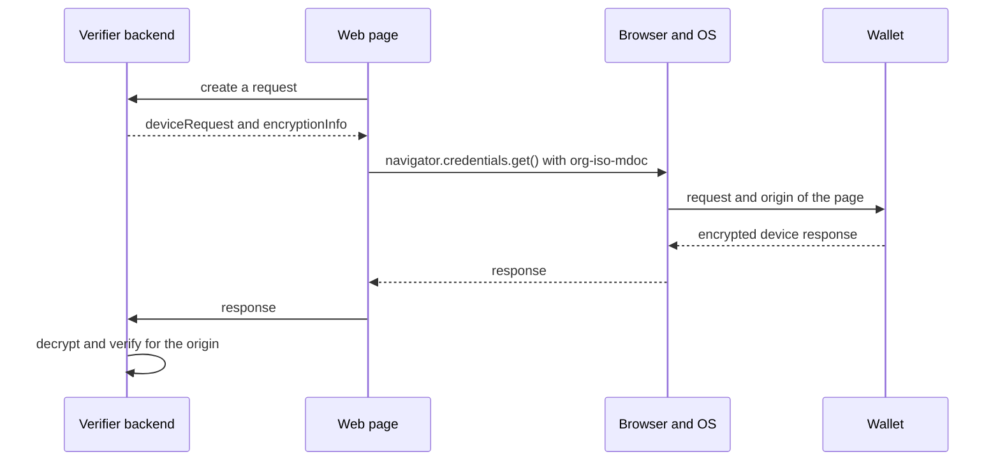

The W3C Digital Credentials API lets a website request credentials through the browser. The browser and the operating system let the user pick a wallet, on the same device or on a phone nearby. ISO/IEC TS 18013-7 Annex C defines `org-iso-mdoc`, a protocol to request mdocs over this API. Credo implements both the verifier and the wallet side in `agent.mdoc`, which is part of `@credo-ts/core`, so you don't need the OpenID4VC module. This page shows a verifier backend, the code for its web page, and the wallet. To use OpenID4VP over the same API, see [Digital Credentials API](../openid4vc/dc-api.mdx) under OpenID4VC.

## How it works



The request has two parts. `deviceRequest` is the ISO 18013-5 device request with the data elements you ask for. `encryptionInfo` holds a nonce and a public key of the verifier, and the wallet encrypts its device response to that key with HPKE. The session transcript contains a hash of `encryptionInfo` and of the origin that the browser passes to the wallet. A response therefore only decrypts and verifies for the origin it was made for, so it can't be relayed from another website.

Annex C has no query language. You list the data elements you need, and the response must contain them. Platform support for the API differs and changes quickly, and some platforms, such as iOS, only accept `org-iso-mdoc`. A page can pass an OpenID4VP request and an `org-iso-mdoc` request in one call, and the wallet answers one of them.

## Set up

`agent.mdoc` is available on every agent. The verifier needs storage for its verification sessions and a KMS for the session keys, here [Askar](../../agent-setup/storage/askar.mdx):

```ts showLineNumbers title="server.ts" mdoc-dc-api.ts section-1
```

The wallet is an agent that holds the mdocs, on Node.js or React Native.

## Create the request

The verifier creates a verification session and returns the request to the page:

```ts showLineNumbers title="server.ts" mdoc-dc-api.ts section-2
```

- `nameSpaces` maps each requested data element to its intent to retain. Pass `{ intentToRetain, optional, source }` instead of a boolean to accept a response without the element (`optional: true`), or with the element signed by the device instead of the issuer (`source: 'deviceSigned'` or `'any'`). Only the intent to retain goes to the wallet.
- By default the response must contain every requested element, issuer signed. With several `docRequests`, set `treatAmbiguousMultipleDocRequestsAsAlternatives` if one of them is enough. The flag isn't part of the request, so the wallet may still answer all of them.
- `readerAuth` signs each document request with your reader certificate, so the wallet can show who is asking. Without it the wallet only knows the origin. The signature covers one origin, so create a session per origin. The certificate's key must be in the verifier's KMS.
- Each session has its own encryption key in the KMS and expires after 5 minutes (`expiresInSeconds`).

## Call the API from the page

```ts showLineNumbers title="page.ts" mdoc-dc-api-browser.ts section-1
```

- `request` goes to the API as it is, as the `data` of an `org-iso-mdoc` request.
- `credential.data` is the encrypted response of the wallet. Post it to your backend as it is.

## Verify the response

```ts showLineNumbers title="server.ts" mdoc-dc-api.ts section-3
```

- `origin` is the origin of your page. Use the value you know, not one from the request: verification fails for any other origin. With `readerAuth`, it's the origin you signed for.
- Credo decrypts the response, verifies each mdoc (issuer signature and certificate chain, element digests, device signature, validity and status), and checks the response against the request. When an element is missing or isn't signed as required, it throws `MdocDeviceRequestNotSatisfiedError`, with the details in `deviceRequestMatch`.
- Trust in the issuer comes from the agent's trust configuration, see [Trusted issuers](../../dids-and-trust/trust.mdx). Pass `trustedCertificates` to set it for one call.
- `deviceResponse.issuerClaims` has the disclosed elements per document type and namespace. `deviceClaims` has the device-signed ones.
- A response for an expired session throws `MdocVerificationSessionExpiredError`. Create a new request.
- Credo doesn't delete sessions or their keys by itself. Delete sessions you're done with, including failed and expired ones, with `deleteVerificationSessionById`, which also deletes the key.

## Respond from a wallet

The operating system passes the request and the origin of the calling website to the wallet app. Registering credentials with the operating system and receiving the request is platform code outside Credo. In a React Native wallet, [`@animo-id/expo-digital-credentials-api`](https://github.com/animo/expo-digital-credentials-api) does this on Android and iOS. Credo does the rest:

```ts showLineNumbers title="wallet.ts" mdoc-dc-api.ts section-4
```

- `resolveDcApiRequest` needs the origin, and rejects a request without one. It verifies reader authentication and matches the stored mdocs against each document request.
- The reader certificate must be trusted: through `trustedReaderCertificates`, or the agent's trust configuration with verification type `mdocReaderAuth`. A signed request from a reader you don't trust throws. `readerAuth.certificateChain` on each document request has the verified chain, leaf first, to show the verifier to the user.
- `success` is `false` when the stored mdocs can't satisfy the request. `validCredentials` lists the matching mdocs per document request.
- `createDcApiResponse` discloses every requested element. Pass `elements` per credential to disclose fewer, for example to leave out the ones the user declined.
- It sends nothing. Hand the returned `{ response }` back to the platform.

## Full example

The verifier backend and the wallet in one process. The script plays the part of the page and the browser:

<details>
<summary>mdoc-dc-api.ts</summary>

```ts showLineNumbers title="mdoc-dc-api.ts" mdoc-dc-api.ts
```

</details>

## Next steps

- [Proximity (ISO 18013-5)](./proximity.mdx): present mdocs in person.
- [Digital Credentials API](../openid4vc/dc-api.mdx): request credentials over the same API with OpenID4VP.
- [Trusted issuers](../../dids-and-trust/trust.mdx): decide which issuers and readers you trust.
