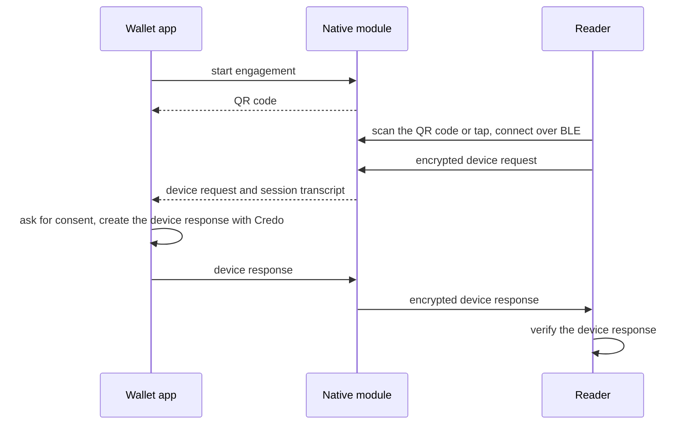

In a proximity presentation the wallet and the verifier's reader are in the same place, for example at a counter, and exchange the request and response over Bluetooth Low Energy (BLE) after the reader scans a QR code or taps the phone. Credo creates the device response in the wallet and verifies it in the reader. The engagement, the transport and the session encryption come from a native module. This page shows a React Native wallet that uses [`expo-mdoc-data-transfer`](https://github.com/openwallet-foundation-labs/expo-mdoc-data-transfer) for that part, and how a reader verifies the response. [ISO mdoc](./index.mdx) explains the messages.

## How it works



The module derives the session keys and the session transcript from the engagement, decrypts the request, and encrypts the response. Your app only handles the decrypted device request and the device response.

Credo doesn't decode or create device requests. In the wallet, decode the request with `@owf/mdoc`, the mdoc library Credo builds on. Credo also doesn't check reader authentication on a proximity request, and only supports device signatures, not device MAC authentication.

## Set up the wallet

<InstallTabs packages="expo-mdoc-data-transfer @owf/mdoc@^0.8.2" />

- Use the `@owf/mdoc` version that `@credo-ts/core` depends on, so the app has one copy.
- Add `expo-mdoc-data-transfer` to the `plugins` in `app.json` and run `npx expo prebuild`. On Android, the module needs `minSdkVersion` 26, and your app requests the Bluetooth permissions at runtime. The [module README](https://github.com/openwallet-foundation-labs/expo-mdoc-data-transfer) has the configuration.
- Bluetooth and NFC don't work in emulators, so test on physical devices.

The wallet itself is an agent with storage and the stored mdocs, see [Your first agent](../../getting-started/first-agent.mdx).

## Engage and receive the request

```ts title="wallet.ts"
import type { Agent } from '@credo-ts/core'
import { DeviceRequest } from '@owf/mdoc'
import { mdocDataTransfer } from 'expo-mdoc-data-transfer'
import { createDeviceResponse } from './mdoc-proximity'

// Returns the device engagement, to show as a QR code
export async function startEngagement() {
  const transfer = mdocDataTransfer.instance()
  const qrCode = await transfer.startQrEngagement()
  // Also lets the reader engage with an NFC tap. Android only.
  transfer.enableNfc()

  return qrCode
}

export async function presentToReader(agent: Agent) {
  const transfer = mdocDataTransfer.instance()

  try {
    // The module decrypts the request and derives the session transcript
    const { deviceRequest, sessionTranscript } = await transfer.waitForDeviceRequest()

    const documentRequests = DeviceRequest.decode(deviceRequest).docRequests.map(({ itemsRequest }) => ({
      docType: itemsRequest.docType,
      nameSpaces: Object.fromEntries(
        Array.from(itemsRequest.namespaces, ([namespace, elements]) => [namespace, Object.fromEntries(elements)])
      ),
    }))

    // Show the requested elements to the user and ask for consent here

    const deviceResponse = await createDeviceResponse(agent, { documentRequests, sessionTranscript })
    await transfer.sendDeviceResponse(deviceResponse)
  } finally {
    transfer.shutdown()
  }
}
```

- Render the string from `startQrEngagement()` as a QR code, for example with `react-native-qrcode-svg`. On iOS, the reader always engages by scanning it.
- `waitForDeviceRequest()` resolves when a reader has connected and sent its request. Call it after you show the QR code.
- `documentRequests` lists, per document type, the requested data elements and the reader's intent to retain each one. Show them to the user before you create the response.
- `shutdown()` ends the session. Call it as well when the user leaves the screen: `useMdocDataTransferShutdownOnUnmount()` from the module does that in a React component.

## Create the device response

This part is plain Credo, so it runs on any platform:

```ts showLineNumbers title="mdoc-proximity.ts" mdoc-proximity.ts section-1
```

- The wallet answers each document request with a stored mdoc of that document type, and skips document types it doesn't have.
- `useInstanceFromCredentialRecord` takes a new instance of an mdoc that was issued in a batch, so readers can't link presentations. When no new instance is left, it reuses the first one.
- `createDeviceResponse` throws when a requested element isn't in the mdoc, so the function only passes the elements the mdoc has. The reader sees the others as missing.
- The session transcript from the module goes in as `sessionTranscriptBytes`. The device key of the mdoc signs over it.
- The result is the encoded `DeviceResponse`. The module encrypts it with the session keys.

## Verify the response as a reader

Credo doesn't implement the reader side of the transport, and `expo-mdoc-data-transfer` only covers the wallet. When your reader app has the device response and the session transcript from its own transport, Credo verifies the response:

```ts showLineNumbers title="mdoc-proximity.ts" mdoc-proximity.ts section-2
```

- `trustedCertificates` are the certificates you trust as issuers, usually the IACA root certificates, as PEM or base64. `verify` doesn't use the agent's trust configuration, so without them every response fails.
- `verify` throws when the response is invalid. It checks the issuer signature and certificate chain, the element digests, the device signature over the session transcript, the validity period and the status.
- It doesn't check that the response contains what you asked for. Check `issuerClaims` (per document type and namespace) yourself.

## Full example

The wallet and a reader in one process, with a fixed session transcript in place of the transport. It imports the two functions above from `mdoc-proximity.ts`:

<details>
<summary>mdoc-proximity-example.ts</summary>

```ts showLineNumbers title="mdoc-proximity-example.ts" mdoc-proximity-example.ts
```

</details>

## Next steps

- [Digital Credentials API (ISO 18013-7)](./dc-api.mdx): request mdocs from a website.
- [mdoc](../../credential-formats/mdoc.mdx): signing, storing and verifying mdocs.
- [Trusted issuers](../../dids-and-trust/trust.mdx): decide which issuers you trust.
