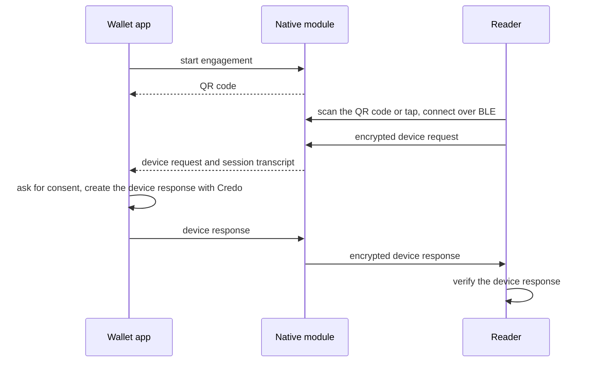

In a proximity presentation the wallet and the verifier's reader are in the same place, for example at a counter, and exchange the request and response over Bluetooth Low Energy (BLE) after the reader scans a QR code or taps the phone. A native module handles the engagement, the transport and the session encryption. Credo creates the device response in the wallet and verifies it in the reader. This page builds a screen for a React Native wallet that uses [`expo-mdoc-data-transfer`](https://github.com/openwallet-foundation-labs/expo-mdoc-data-transfer), then shows how a reader verifies the response. [ISO mdoc](./index.mdx) explains the messages.

[Paradym Wallet](https://github.com/animo/paradym-wallet), an open source wallet built on Credo, presents mdocs in person this way. See its [proximity code](https://github.com/animo/paradym-wallet/blob/main/apps/wallet/src/features/proximity/mdocProximity.ts).

## How it works



The module derives the session keys and the session transcript from the engagement, decrypts the request, and encrypts the response. Your app only handles the decrypted device request and the device response.

Credo doesn't decode device requests, so the wallet decodes them with `@owf/mdoc`, the mdoc library Credo builds on. Credo also doesn't check reader authentication on a proximity request, and only supports device signatures, not device MAC authentication.

## Wallet

### Set up

<InstallTabs packages="expo-mdoc-data-transfer expo-build-properties @owf/mdoc@^0.8.2 react-native-qrcode-svg react-native-svg" />

Add the config plugins to `app.json` and run `npx expo prebuild`:

```json title="app.json"
{
  "expo": {
    "plugins": [
      "expo-mdoc-data-transfer",
      ["expo-build-properties", { "android": { "minSdkVersion": 26 }, "ios": { "useFrameworks": "dynamic" } }]
    ]
  }
}
```

- Use the `@owf/mdoc` version that `@credo-ts/core` depends on, so the app has one copy.
- The config plugin adds the Bluetooth and NFC permissions and the NFC engagement service to the Android manifest. See the [module README](https://github.com/openwallet-foundation-labs/expo-mdoc-data-transfer#readme).
- Dynamic frameworks on iOS change how every pod links. Paradym Wallet keeps some pods static, `askar` and `anoncreds` among them, with the plugin option `ios.buildStatic`.

Bluetooth and NFC don't work in emulators, so test on physical devices. Android also asks the user for the Bluetooth permissions at runtime:

:::holder

```ts showLineNumbers title="mdoc-proximity-wallet.tsx" mdoc-proximity-wallet.tsx section-3
```

:::

The wallet itself is an agent with storage and the stored mdocs, see [Your first agent](../../getting-started/first-agent.mdx). The screen below gets it as a prop.

### Engage and receive the request

When the user taps the button, the screen starts the engagement, shows the QR code and waits for the reader's request:

:::holder

```tsx showLineNumbers title="mdoc-proximity-wallet.tsx" mdoc-proximity-wallet.tsx section-1
```

:::

`startQrEngagement()` returns the device engagement to show as a QR code. On iOS, the reader always engages by scanning it. `waitForDeviceRequest()` resolves when a reader has connected and sent its request, and rejects when the transfer fails.

`decodeDeviceRequest` reads the requested data elements from the request:

:::holder

```ts showLineNumbers title="mdoc-proximity.ts" mdoc-proximity.ts section-1
```

:::

`documentRequests` lists, per document type, the requested data elements and the reader's intent to retain each one. The screen shows them to the user before it shares anything.

### Create and send the device response

When the user agrees, the screen creates the device response and hands it to the module. `shutdown()` ends the session, and `useMdocDataTransferShutdownOnUnmount()` in the full example also does that when the user leaves the screen:

:::holder

```tsx showLineNumbers title="mdoc-proximity-wallet.tsx" mdoc-proximity-wallet.tsx section-2
```

:::

The device response itself is plain Credo:

:::holder

```ts showLineNumbers title="mdoc-proximity.ts" mdoc-proximity.ts section-2
```

:::

- `createDeviceResponse` throws when a requested element isn't in the mdoc, so the function only passes the elements the mdoc has. The reader sees the others as missing.
- `useInstanceFromCredentialRecord` takes a new instance of an mdoc issued in a batch, so readers can't link presentations. When no new instance is left, it reuses the first one.

The session transcript from the module goes in as `sessionTranscriptBytes`, and the device key of the mdoc signs over it. The module encrypts the returned `DeviceResponse` with the session keys.

## Reader

Credo doesn't implement the reader side of the transport, and `expo-mdoc-data-transfer` only covers the wallet. When your reader app has the device response and the session transcript from its own transport, Credo verifies the response:

:::verifier

```ts showLineNumbers title="mdoc-proximity.ts" mdoc-proximity.ts section-3
```

:::

- `verify` doesn't use the agent's trust configuration. Pass the certificates of the issuers you trust, usually the IACA root certificates, as `trustedCertificates`, or every response fails.
- `verify` throws when the response is invalid. It checks the issuer signature and certificate chain, the element digests, the device signature over the session transcript, the validity period and the status. It doesn't check that the response contains what you asked for, so check `issuerClaims` (per document type and namespace) yourself.

## Full example

The wallet screen, and the Credo functions it and the reader use. Render `PresentInPersonScreen` with the wallet's agent.

<Tabs>
<TabItem value="screen" label="mdoc-proximity-wallet.tsx">

```tsx showLineNumbers title="mdoc-proximity-wallet.tsx" mdoc-proximity-wallet.tsx
```

</TabItem>
<TabItem value="credo" label="mdoc-proximity.ts">

```ts showLineNumbers title="mdoc-proximity.ts" mdoc-proximity.ts
```

</TabItem>
</Tabs>

## Next steps

- [Digital Credentials API](../dc-api/index.mdx): request mdocs from a website.
- [mdoc](../../credential-formats/mdoc.mdx): signing, storing and verifying mdocs.
- [Trusted issuers](../../dids-and-trust/trust.mdx): decide which issuers you trust.
