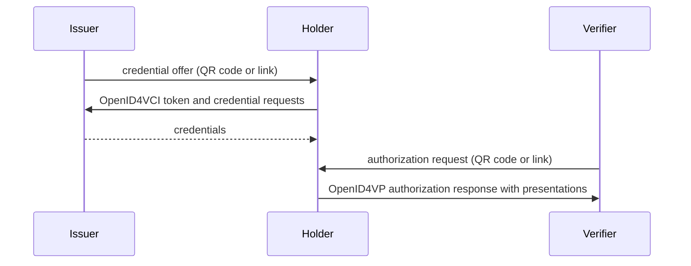

# OpenID4VC

> Issue, receive and verify credentials over HTTPS with OpenID4VCI and OpenID4VP, using the @credo-ts/openid4vc module.

OpenID for Verifiable Credentials (OpenID4VC) is a family of protocols, built on OAuth 2.0, for issuing and presenting credentials over HTTPS. This page explains the protocols and roles, and how to set up the `@credo-ts/openid4vc` module. The pages below it cover each role.

## Protocols

| Specification | What it covers |
| --- | --- |
| OpenID4VCI | Issuance. A holder gets credentials from an issuer. The issuer authorizes it with a pre-authorized code in the offer, or with the OAuth authorization code flow. |
| OpenID4VP | Presentation. A verifier sends an authorization request with a DCQL query, and the holder responds with presentations of matching credentials. |
| HAIP | The High Assurance Interoperability Profile of both protocols, used by ecosystems such as the EU Digital Identity Wallet. It requires SD-JWT VC or mdoc. For issuance: the authorization code flow with PKCE, DPoP, and wallet authentication, usually with wallet attestations. For presentation: DCQL, requests signed with an X.509 certificate (`x509_hash`) and encrypted responses. [Authorization and wallet security](https://credo.js.org/guides/protocols/openid4vc/authorization.md) explains the issuance part, [Verifying credentials](https://credo.js.org/guides/protocols/openid4vc/verifier.md) the presentation part. |

There is no connection between the parties. Each exchange is a separate session, started by a credential offer or an authorization request that the holder receives as a QR code or link.



[Supported standards](https://credo.js.org/guides/supported-standards.md) lists the versions and drafts Credo supports, and which credential formats work with each protocol.

## Roles

| Role | API | Platform | Guide |
| --- | --- | --- | --- |
| Issuer | `agent.openid4vc.issuer` | Node.js | [Issuing credentials](https://credo.js.org/guides/protocols/openid4vc/issuer.md) |
| Holder | `agent.openid4vc.holder` | Node.js and React Native | [Receiving](https://credo.js.org/guides/protocols/openid4vc/receive.md) and [presenting](https://credo.js.org/guides/protocols/openid4vc/present.md) credentials |
| Verifier | `agent.openid4vc.verifier` | Node.js | [Verifying credentials](https://credo.js.org/guides/protocols/openid4vc/verifier.md) |

Issuers and verifiers serve HTTP endpoints with Express, so they run on Node.js. On React Native only the holder is available.

## Install

```bash
npm install @credo-ts/openid4vc@^0.7.2
```

For an issuer or verifier, also install Express 5:

```bash
npm install express@^5
```
```bash
npm install --save-dev @types/express@^5
```

## Configure the module

An agent that issues and verifies credentials:

```ts
import { Agent } from '@credo-ts/core'
import { agentDependencies } from '@credo-ts/node'
import { OpenId4VcModule } from '@credo-ts/openid4vc'
import express from 'express'

const app = express()

const agent = new Agent({
  dependencies: agentDependencies,
  modules: {
    ...storage, // Storage and key management, see Agent setup
    // The key must be `openid4vc` for the module to be available as agent.openid4vc
    openid4vc: new OpenId4VcModule({
      app,
      issuer: {
        baseUrl: 'https://example.com/oid4vci',
        credentialRequestToCredentialMapper,
      },
      verifier: {
        baseUrl: 'https://example.com/oid4vp',
      },
    }),
  },
})

await agent.initialize()

// Credo adds its routes to the app, you start the server. Make https://example.com
// reach this server, for example through a reverse proxy.
const server = app.listen(4022)
```

Register the module under the key `openid4vc`, so it's available as `agent.openid4vc`. `issuer` and `verifier` are optional and turn on that role. The holder is always available, so a wallet registers the module without options:

```ts
openid4vc: new OpenId4VcModule(),
```

The module stores issuers, verifiers and sessions as records. With [Drizzle storage](https://credo.js.org/guides/agent-setup/storage/drizzle.md), add `openid4vcBundle` from `@credo-ts/drizzle-storage/openid4vc` to the bundles.

`baseUrl` is the public URL of the endpoints, and Credo serves them under its path (`/oid4vci` and `/oid4vp` here). OpenID4VCI also requires the issuer metadata at the root of the host (`/.well-known/openid-credential-issuer/oid4vci/<issuerId>`), so your server must pass requests for the whole host to the Express app.

`app` is your Express app. Without it, Credo creates one, available as `agent.openid4vc.config.app`. Either way, you start the server. Credo adds its routes during `agent.initialize()`, so register your own middleware and routes after that.

The issuer and verifier support [multi-tenancy](https://credo.js.org/guides/agent-setup/multi-tenancy.md): Credo finds the tenant from the issuer or verifier id in the URL.

For local development over `http://localhost`, set `allowInsecureHttpUrls: true` in the agent config of all parties. Never enable it in production.

## The example flow

The pages for each role build one example: an issuer that issues an employee badge as an SD-JWT VC with the pre-authorized code flow, a holder that receives and presents it, and a verifier that requests two of its claims. This runs them in one process:

```ts
import { holder, presentCredential, receiveCredential } from './openid4vc-holder.js'
import { createEmployeeBadgeOffer, issuer, issuerServer } from './openid4vc-issuer.js'
import { createEmployeeBadgeRequest, getEmployeeBadgeClaims, verifier, verifierServer } from './openid4vc-verifier.js'

// Issuer: create an offer for a known user
const { credentialOffer, txCode } = await createEmployeeBadgeOffer('employee-123')

// Holder: resolve the offer, enter the code, store the credential
await receiveCredential(credentialOffer, txCode)

// Verifier: request given_name and department
const { authorizationRequest, verificationSessionId } = await createEmployeeBadgeRequest()

// Holder: resolve the request and share the credential
await presentCredential(authorizationRequest)

// Verifier: read the verified claims
console.log(await getEmployeeBadgeClaims(verificationSessionId))
```
