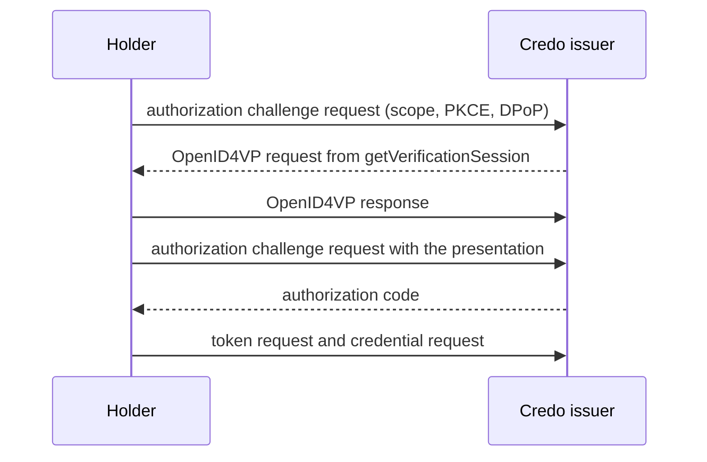

# Issuance authorization and wallet security

> Choose an OpenID4VCI authorization flow, use Credo's authorization server, a chained or an external one, presentation during issuance, PKCE, DPoP, and wallet and key attestations.

This page is about issuance (OpenID4VCI): how an issuer decides who gets a credential beyond the pre-authorized code, and the protections that profiles such as HAIP ask for when a wallet requests credentials: PKCE, DPoP, wallet attestations and key attestations. Each section has an issuer part and a holder part. For the verifier side of security, such as signed requests and encrypted responses, see [Verifying credentials](https://credo.js.org/guides/protocols/openid4vc/verifier.md). [Issuing credentials](https://credo.js.org/guides/protocols/openid4vc/issuer.md) and [Receiving credentials](https://credo.js.org/guides/protocols/openid4vc/receive.md) explain the basics.

## Choose an authorization flow

| Flow | Who authenticates the user | Use when | Configure with |
| --- | --- | --- | --- |
| Pre-authorized code | Your application, before it creates the offer | You already know the user, for example after a login on your website. | `preAuthorizedCodeFlowConfig`, see [Issuing credentials](https://credo.js.org/guides/protocols/openid4vc/issuer.md) |
| Presentation during issuance | Credo, which asks the holder to present a credential with OpenID4VP | The user proves who they are with a credential they already have, such as a PID. | `requirePresentationDuringIssuance` and `getVerificationSession` |
| Chained authorization server | Your identity provider, with Credo's authorization server in between | Users log in with your existing OpenID Connect provider. | `authorizationServerConfigs` with `type: 'chained'` |
| External authorization server | Your OAuth 2.0 authorization server, which holders use directly | You run an authorization server that already supports OpenID4VCI. | `authorizationServerConfigs` with `type: 'direct'` |

Start with the pre-authorized code. HAIP requires the authorization code flow, which the other three use. When users have to log in, prefer a chained authorization server over an external one: Credo's authorization server then still handles PAR, PKCE, DPoP and wallet attestations, which an external server has to implement itself.

Every credential configuration you offer with the authorization code flow needs a `scope`. Credo's built-in authorization server handles the first three flows, and requires pushed authorization requests (PAR).

## Security features

| Feature | Protects against | HAIP | Credo issuer default |
| --- | --- | --- | --- |
| PKCE | Another app redeeming an intercepted authorization code | Required, with `S256` | Off |
| DPoP | Someone else using a stolen access token. DPoP binds the token to a key of the holder. | Required | Off |
| Wallet attestation | Wallet apps you don't trust getting credentials. The wallet authenticates with an attestation from its wallet provider. | Issuers must authenticate wallets, usually with wallet attestations | Off |
| Key attestation | Credentials bound to keys without the protection you need, for example outside a secure element | Wallets must support them | Off, set per credential configuration |

For an issuer: turn on PKCE and DPoP. Require wallet and key attestations only when the wallets you issue to get them from their wallet provider, as in the EU Digital Identity Wallet ecosystem. Wallets without them can't get your credentials.

For a wallet: the Credo holder uses PKCE and DPoP automatically when the issuer supports them. Wallet and key attestations need a backend from your wallet provider, see [Wallet and key attestations](#wallet-and-key-attestations).

### Module and session options

Each requirement has a module option that applies to all issuance sessions, and an option per session: in `authorization` when you create an offer, or in the result of `getDynamicIssuanceSession` for wallet-initiated issuance.

| Module option | Per session | Default |
| --- | --- | --- |
| `pkceRequired` | `requirePkce` | `false` |
| `dpopRequired` | `requireDpop` | `false` |
| `walletAttestationsRequired` | `requireWalletAttestation` | `false` |

If you leave the per-session option out, the module option applies. `requirePkce: false` turns PKCE off for that session, even when the module option requires it. `requireDpop: false` and `requireWalletAttestation: false` fall back to the module option, so you can't turn a requirement of the module off for one session.

These options apply to Credo's authorization server. An external authorization server enforces its own rules. Credo only checks at the credential endpoint that the access token is bound with DPoP when the offer sets `requireDpop: true`.

## Presentation during issuance

The issuer asks the holder to present a credential, for example a PID, before it issues a new one. Credo creates the presentation request, verifies the response and only then gives the holder an authorization code:



### Issuer

The issuer agent also needs the verifier part of the module, and a `getVerificationSession` callback:

:::issuer

```ts
const issuer = new Agent({
  config: { allowInsecureHttpUrls: true },
  dependencies: agentDependencies,
  modules: {
    ...issuerStorage, // Storage and key management, see Agent setup
    openid4vc: new OpenId4VcModule({
      app,
      issuer: {
        baseUrl: `${issuerUrl}/oid4vci`,
        credentialRequestToCredentialMapper,
        // Creates the OpenID4VP request for presentation during issuance
        getVerificationSession,
        // Require DPoP and PKCE for all issuance sessions. PKCE is off by default.
        dpopRequired: true,
        pkceRequired: true,
      },
      // Presentation during issuance uses the verifier of the same agent
      verifier: { baseUrl: `${issuerUrl}/oid4vp` },
    }),
  },
})
```

:::

The callback creates the OpenID4VP request when a holder starts the authorization. `scopes` are the requested scopes that match the offered credentials. Return the request together with the scopes it grants. The request needs a verifier record, here one with the same id as the issuer:

:::issuer

```ts
const getVerificationSession: OpenId4VciGetVerificationSession = async ({ agentContext, issuanceSession, scopes }) => {
  if (!scopes.includes('diploma')) throw new Error(`Unsupported scopes ${scopes.join(', ')}`)

  // Resolve the verifier from the agent context, so this also works for tenants
  const verifier = agentContext.resolve(OpenId4VcVerifierApi)
  const authorizationRequest = await verifier.createAuthorizationRequest({
    // A verifier with the same id as the issuer (created next to the issuer)
    verifierId: issuanceSession.issuerId,
    requestSigner: { method: 'x5c', x5c: [issuerCertificate] },
    dcql: {
      query: {
        credentials: [
          {
            id: 'pid',
            format: 'dc+sd-jwt',
            meta: { vct_values: ['urn:example:pid:1'] },
            claims: [{ path: ['given_name'] }, { path: ['family_name'] }],
          },
        ],
      },
    },
  })

  // The scopes that are granted once the presentation is verified
  return { ...authorizationRequest, scopes: ['diploma'] }
}
```

:::

Create the issuer with a `scope` per credential configuration, and an offer that requires the presentation. Leave `authorizationServerUrl` out (or set it to the issuer itself), as only Credo's authorization server handles this flow:

:::issuer

```ts
const issuerRecord = await issuer.openid4vc.issuer.createIssuer({
  issuerId: 'example-issuer',
  // Advertise DPoP support in the authorization server metadata
  dpopSigningAlgValuesSupported: [KnownJwaSignatureAlgorithms.ES256],
  credentialConfigurationsSupported: {
    diploma: {
      format: OpenId4VciCredentialFormatProfile.SdJwtDc,
      vct: 'urn:example:diploma:1',
      // Required for the authorization code flow
      scope: 'diploma',
      cryptographic_binding_methods_supported: ['jwk'],
      proof_types_supported: {
        jwt: { proof_signing_alg_values_supported: [KnownJwaSignatureAlgorithms.ES256] },
      },
    },
  },
})
await issuer.openid4vc.verifier.createVerifier({ verifierId: issuerRecord.issuerId })

const { credentialOffer } = await issuer.openid4vc.issuer.createCredentialOffer({
  issuerId: issuerRecord.issuerId,
  credentialConfigurationIds: ['diploma'],
  authorizationCodeFlowConfig: { requirePresentationDuringIssuance: true },
})
```

:::

The mapper receives the verified presentation in `verification`:

:::issuer

```ts
const credentialRequestToCredentialMapper: OpenId4VciCredentialRequestToCredentialMapper = async ({
  credentialConfiguration,
  holderBinding,
  verification,
}) => {
  if (credentialConfiguration.format !== OpenId4VciCredentialFormatProfile.SdJwtDc) {
    throw new Error(`Unsupported credential format ${credentialConfiguration.format}`)
  }
  if (holderBinding.bindingMethod !== 'jwk') throw new Error('Expected jwk holder binding')

  // The verified presentation from the authorization step
  const [pid] = verification?.dcql?.presentations.pid ?? []
  if (pid?.claimFormat !== ClaimFormat.SdJwtDc) throw new Error('Expected a verified PID presentation')

  return {
    type: 'credentials',
    format: ClaimFormat.SdJwtDc,
    credentials: holderBinding.keys.map((holder) => ({
      holder,
      issuer: { method: 'x5c', x5c: [issuerCertificate], issuer: issuerUrl },
      payload: {
        vct: credentialConfiguration.vct,
        name: `${pid.prettyClaims.given_name} ${pid.prettyClaims.family_name}`,
        degree: 'Bachelor of Science',
      },
      disclosureFrame: { _sd: ['name', 'degree'] },
    })),
  } satisfies OpenId4VciSignSdJwtCredentials
}
```

:::

### Holder

:::holder

```ts
const clientId = 'example-wallet'
const redirectUri = 'https://wallet.example.com/redirect'

const resolvedOffer = await holder.openid4vc.holder.resolveCredentialOffer(credentialOffer)
const authorization = await holder.openid4vc.holder.resolveOpenId4VciAuthorizationRequest(resolvedOffer, {
  clientId,
  redirectUri,
  scope: getScopesFromCredentialConfigurationsSupported(resolvedOffer.offeredCredentialConfigurations),
})
if (authorization.authorizationFlow !== OpenId4VciAuthorizationFlow.PresentationDuringIssuance) {
  throw new Error('Expected presentation during issuance')
}

// Present the PID with OpenID4VP
const presentationRequest = await holder.openid4vc.holder.resolveOpenId4VpAuthorizationRequest(
  authorization.openid4vpRequestUrl
)
if (!presentationRequest.dcql?.queryResult.can_be_satisfied) throw new Error('No matching credentials')
const presentation = await holder.openid4vc.holder.acceptOpenId4VpAuthorizationRequest({
  authorizationRequestPayload: presentationRequest.authorizationRequestPayload,
  dcql: { credentials: holder.openid4vc.holder.selectCredentialsForDcqlRequest(presentationRequest.dcql.queryResult) },
})
if (!presentation.ok) throw new Error('Presentation was rejected')

// Exchange the presentation for an authorization code
const { authorizationCode, dpop } = await holder.openid4vc.holder.retrieveAuthorizationCodeUsingPresentation({
  resolvedCredentialOffer: resolvedOffer,
  authSession: authorization.authSession,
  presentationDuringIssuanceSession: presentation.presentationDuringIssuanceSession,
  dpop: authorization.dpop,
})

const token = await holder.openid4vc.holder.requestToken({
  resolvedCredentialOffer: resolvedOffer,
  code: authorizationCode,
  clientId,
  redirectUri,
  // PKCE: proves this is the client that started the authorization
  codeVerifier: authorization.codeVerifier,
  // Keep using the same DPoP key
  dpop,
})

const { credentials } = await holder.openid4vc.holder.requestCredentials({
  resolvedCredentialOffer: resolvedOffer,
  ...token,
  clientId,
  credentialBindingResolver: async () => {
    const key = await holder.kms.createKey({ type: { kty: 'EC', crv: 'P-256' } })
    return { method: 'jwk', keys: [PublicJwk.fromPublicJwk(key.publicJwk)] }
  },
})
```

:::

`resolveOpenId4VciAuthorizationRequest` starts the authorization. `authorizationFlow` tells you whether the issuer wants a presentation or a browser redirect ([below](#external-authorization-servers)). Present the credential like any other OpenID4VP request: the result has `presentationDuringIssuanceSession`, which proves the presentation to the issuer. Pass `codeVerifier` (PKCE) and the `dpop` from the previous call to the token request.

## External authorization servers

### Issuer: chained

With a chained authorization server, holders talk to Credo's authorization server, which sends the user to your identity provider to log in. PAR, PKCE, DPoP and wallet attestations work as with Credo alone:

:::issuer

```ts
// Wallets use Credo's authorization server, which sends the user to your identity provider
const chainedIssuer = await issuer.openid4vc.issuer.createIssuer({
  issuerId: 'employee-chained',
  credentialConfigurationsSupported,
  authorizationServerConfigs: [
    {
      type: 'chained',
      issuer: 'https://idp.example.com',
      // Credo's client at the identity provider. Register
      // https://issuer.example.com/oid4vci/employee-chained/redirect as its redirect URI.
      clientAuthentication: { type: 'clientSecret', clientId: 'credo-issuer', clientSecret: 'secret' },
      // Credential scope -> scopes to request from the identity provider
      scopesMapping: { employee: ['openid', 'profile'] },
    },
  ],
})

await issuer.openid4vc.issuer.createCredentialOffer({
  issuerId: chainedIssuer.issuerId,
  credentialConfigurationIds: ['employee'],
  // Selects the chained authorization server
  authorizationCodeFlowConfig: { authorizationServerUrl: 'https://idp.example.com' },
})
```

:::

- Credo exchanges the code at your identity provider with `clientAuthentication`. Register `<baseUrl>/<issuerId>/redirect` as the redirect URI of that client.
- `scopesMapping` maps each credential scope to the scopes Credo requests from your identity provider. To decide per session instead, use the `getChainedAuthorizationRequestParameters` callback in the issuer module config.
- Set `redirectUris` to the redirect URIs of the wallets you accept. Without it, Credo accepts any redirect URI.

In the mapper, the token response of your identity provider, including an `id_token`, is in `issuanceSession.chainedIdentity.externalAccessTokenResponse`. A chained flow can't be combined with presentation during issuance.

### Issuer: direct

With a direct authorization server, Credo lists it in the issuer metadata, and holders use it directly:

:::issuer

```ts
// Wallets use your authorization server directly
const directIssuer = await issuer.openid4vc.issuer.createIssuer({
  issuerId: 'employee-direct',
  credentialConfigurationsSupported,
  authorizationServerConfigs: [
    {
      type: 'direct',
      issuer: 'https://auth.example.com',
      // Only needed if Credo has to introspect the access tokens
      clientAuthentication: { clientId: 'credo-issuer', clientSecret: 'secret' },
    },
  ],
})

await issuer.openid4vc.issuer.createCredentialOffer({
  issuerId: directIssuer.issuerId,
  credentialConfigurationIds: ['employee'],
  authorizationCodeFlowConfig: { authorizationServerUrl: 'https://auth.example.com' },
})
```

:::

Your authorization server must link the authorization to the offer through `issuer_state`, and handle PAR, PKCE, DPoP and wallet attestations itself if you need them. Credo verifies its access tokens at the credential endpoint, and only needs `clientAuthentication` for token introspection. For issuance without an offer, where the access token isn't linked to an issuance session, use `getDynamicIssuanceSession`.

### Holder

With both kinds, the holder opens the authorization URL in a browser and receives the code on its redirect URI:

:::holder

```ts
/**
 * `openAuthorizationUrl` opens the URL in a browser and resolves with the URL the
 * authorization server redirected to, for example using an in-app browser session.
 */
export async function receiveWithRedirect(
  credentialOffer: string,
  openAuthorizationUrl: (authorizationRequestUrl: string) => Promise<string>
) {
  const clientId = 'example-wallet'
  const redirectUri = 'https://wallet.example.com/redirect'

  const resolvedOffer = await holder.openid4vc.holder.resolveCredentialOffer(credentialOffer)
  const authorization = await holder.openid4vc.holder.resolveOpenId4VciAuthorizationRequest(resolvedOffer, {
    clientId,
    redirectUri,
    scope: getScopesFromCredentialConfigurationsSupported(resolvedOffer.offeredCredentialConfigurations),
  })
  if (authorization.authorizationFlow !== OpenId4VciAuthorizationFlow.Oauth2Redirect) {
    throw new Error('Expected a redirect to the authorization server')
  }

  const authorizationResponseRedirectUrl = await openAuthorizationUrl(authorization.authorizationRequestUrl)
  const { authorizationCode } = holder.openid4vc.holder.parseAuthorizationCodeFromAuthorizationResponse({
    authorizationResponseRedirectUrl,
    resolvedCredentialOffer: resolvedOffer,
  })

  const token = await holder.openid4vc.holder.requestToken({
    resolvedCredentialOffer: resolvedOffer,
    code: authorizationCode,
    clientId,
    redirectUri,
    codeVerifier: authorization.codeVerifier,
    // Bound to the DPoP key used for the pushed authorization request, if any
    dpop: authorization.dpop,
  })

  return holder.openid4vc.holder.requestCredentials({
    resolvedCredentialOffer: resolvedOffer,
    ...token,
    clientId,
    credentialBindingResolver: async () => {
      const key = await holder.kms.createKey({ type: { kty: 'EC', crv: 'P-256' } })
      return { method: 'jwk', keys: [PublicJwk.fromPublicJwk(key.publicJwk)] }
    },
  })
}
```

:::

The authorization request goes through PAR when the authorization server supports it. When the server supports PKCE, Credo adds it and returns the `codeVerifier` for the token request.

## PKCE and DPoP

### Issuer

PKCE ties the authorization code to the holder that started the authorization. Credo's authorization server doesn't require it by default. Turn it on with `pkceRequired: true`, as in the [full example](#full-example). Credo only supports the `S256` method. When a holder sends a code challenge, Credo always checks the code verifier, also for sessions that don't require PKCE.

DPoP binds the access token to a key of the holder. Enable it on the issuer record with `dpopSigningAlgValuesSupported`, as in the [presentation during issuance](#presentation-during-issuance) example: Credo only advertises DPoP when it's set. Require it with `dpopRequired` or `requireDpop`. When a holder uses DPoP in its first request, Credo requires it for the rest of that session.

### Holder

Credo creates the PKCE code challenge when the authorization server supports PKCE, and returns `codeVerifier`. Pass it to `requestToken`. Credo uses DPoP when the authorization server supports it. Each call returns the `dpop` options for the next call, as in the examples above. Spreading the token response into `requestCredentials` passes them on.

## Wallet and key attestations

A wallet attestation is a JWT from the wallet provider (the organization behind the wallet app) that says the wallet is a genuine instance of its app. The wallet uses it to authenticate to the authorization server ([OAuth 2.0 Attestation-Based Client Authentication](https://datatracker.ietf.org/doc/draft-ietf-oauth-attestation-based-client-auth/)).

A key attestation lists keys of the wallet and how they're protected, such as in a secure element, with levels from ISO/IEC 18045 (`iso_18045_high`, `iso_18045_moderate`, `iso_18045_enhanced-basic`, `iso_18045_basic`). The issuer can require it before it binds credentials to those keys.

Both come from the wallet provider's backend. Credo doesn't create them.

### Issuer

Trust the wallet provider, for example with `getTrustedIssuersForVerification` in the agent config:

:::issuer

```ts
// Trust the wallet provider for wallet attestations and key attestations
const getTrustedIssuersForVerification: GetTrustedIssuersForVerification<
  VerificationSigner,
  OpenId4VcVerificationTypes
> = async (_agentContext, { verification }) => {
  if (verification.type === 'oauth2ClientAttestation' || verification.type === 'openId4VciKeyAttestation') {
    return { trustedIssuers: [{ method: 'x509', issuance: [walletProviderCertificate.toString('pem')] }] }
  }

  // Use the other trust configuration for everything else
  return undefined
}
```

:::

Credo checks attestations signed with an X.509 certificate against your trust configuration, and accepts DID-signed attestations unless you return a list of trusted DIDs. See [Trusted issuers](https://credo.js.org/guides/dids-and-trust/trust.md).

:::warning

Your trust configuration only applies to attestations signed with an `x5c` certificate chain or a DID. Credo accepts an attestation signed with a bare JWK (a `jwk` header) from anyone whose signature verifies, so it proves nothing about the wallet provider.

:::

Then require wallet attestations, advertise attestation-based client authentication (`clientAttestationSigningAlgValuesSupported` and `clientAttestationPopSigningAlgValuesSupported`), and set the key attestation requirements:

:::issuer

```ts
config: { allowInsecureHttpUrls: true, getTrustedIssuersForVerification },
dependencies: agentDependencies,
modules: {
  ...issuerStorage, // Storage and key management, see Agent setup
  openid4vc: new OpenId4VcModule({
    app,
    issuer: {
      baseUrl: `${issuerUrl}/oid4vci`,
      credentialRequestToCredentialMapper,
      // Every issuance session requires a wallet attestation
      walletAttestationsRequired: true,
    },
  }),
},
```

```ts
const issuerRecord = await issuer.openid4vc.issuer.createIssuer({
  issuerId: 'example-issuer',
  // Advertise attestation based client authentication
  clientAttestationSigningAlgValuesSupported: [KnownJwaSignatureAlgorithms.ES256],
  clientAttestationPopSigningAlgValuesSupported: [KnownJwaSignatureAlgorithms.ES256],
  batchCredentialIssuance: { batchSize: 2 },
  credentialConfigurationsSupported: {
    membership: {
      format: OpenId4VciCredentialFormatProfile.MsoMdoc,
      doctype: 'org.example.membership.1',
      cryptographic_binding_methods_supported: ['cose_key'],
      proof_types_supported: {
        jwt: {
          proof_signing_alg_values_supported: [KnownJwaSignatureAlgorithms.ES256],
          // The holder keys must be attested at this level
          key_attestations_required: {
            key_storage: [OpenId4VciKeyAttestationLevel.High],
            user_authentication: [OpenId4VciKeyAttestationLevel.High],
          },
        },
      },
    },
  },
})
```

:::

`key_attestations_required` on a proof type requires a key attestation with at least these levels. A higher level satisfies a lower one. Add an `attestation` proof type as well if wallets may send the key attestation as the proof itself.

By default Credo verifies a wallet attestation whenever a wallet sends one, and then requires it for the rest of the session. `ignoreWalletAttestationsWhenNotRequired` ignores attestations for sessions that don't require them. `clientAttestationPopChallengeRequired` makes wallets fetch a challenge for the proof of possession first.

The mapper gets the attested keys in `holderBinding.keys`, and the verified key attestation in `holderBinding.keyAttestation`:

:::issuer

```ts
const credentialRequestToCredentialMapper: OpenId4VciCredentialRequestToCredentialMapper = async ({
  credentialConfiguration,
  holderBinding,
}) => {
  if (credentialConfiguration.format !== OpenId4VciCredentialFormatProfile.MsoMdoc) {
    throw new Error(`Unsupported credential format ${credentialConfiguration.format}`)
  }
  if (holderBinding.bindingMethod !== 'jwk') throw new Error('Expected jwk holder binding')

  // Credo verified the key attestation, its trust and the required levels
  console.log('Attested key storage', holderBinding.keyAttestation?.payload.key_storage)

  return {
    type: 'credentials',
    format: ClaimFormat.MsoMdoc,
    // One credential per attested key
    credentials: holderBinding.keys.map(({ jwk }) => ({
      docType: credentialConfiguration.doctype,
      holderKey: jwk,
      issuerCertificate,
      validityInfo: { validUntil: new Date(Date.now() + 365 * 24 * 60 * 60 * 1000) },
      namespaces: { 'org.example.membership.1': { member_id: 'M-1234', issuing_country: 'NL' } },
    })),
  } satisfies OpenId4VciSignMdocCredentials
}
```

:::

### Holder

:::holder

```ts
const resolvedOffer = await holder.openid4vc.holder.resolveCredentialOffer(credentialOffer)

// Credo signs the attestation proof of possession with the key in the attestation's `cnf`
const token = await holder.openid4vc.holder.requestToken({
  resolvedCredentialOffer: resolvedOffer,
  walletAttestationJwt,
})

const { credentials } = await holder.openid4vc.holder.requestCredentials({
  resolvedCredentialOffer: resolvedOffer,
  ...token,
  clientId,
  credentialBindingResolver: ({ proofTypes }) => {
    if (!proofTypes.jwt?.keyAttestationsRequired) throw new Error('Expected key attestations to be required')

    // Without a nonce, Credo sends a jwt proof signed with the first attested key
    return { method: 'attestation', keyAttestationJwt }
  },
})
```

:::

Pass `walletAttestationJwt` to every call to the authorization server: `resolveOpenId4VciAuthorizationRequest`, `retrieveAuthorizationCodeUsingPresentation`, `requestToken` and `refreshToken`. Credo signs the proof of possession with the key in the attestation's `cnf`, so that key must be in the wallet's KMS.

When the issuer requires key attestations, `proofTypes.jwt.keyAttestationsRequired` (or `proofTypes.attestation`) says so, and the binding resolver must return `{ method: 'attestation', keyAttestationJwt }`. Binding to a DID isn't possible then. The attested keys must be in the wallet's KMS, with their KMS key id as `kid`, and you get one credential instance per attested key. Without a `nonce` in the key attestation, Credo sends a `jwt` proof signed with the first attested key. With the issuer's `cNonce` (passed to the resolver) as `nonce`, it sends the key attestation as an `attestation` proof.

## Full example

Presentation during issuance with PKCE and DPoP, in one process:

<details>
<summary>openid4vc-auth.ts</summary>

```ts
import { Agent, ClaimFormat, SdJwtVcRecord, type X509Certificate } from '@credo-ts/core'
import { KnownJwaSignatureAlgorithms, PublicJwk } from '@credo-ts/core/kms'
import { openid4vcBundle } from '@credo-ts/drizzle-storage/openid4vc'
import { agentDependencies } from '@credo-ts/node'
import {
  getScopesFromCredentialConfigurationsSupported,
  OpenId4VciAuthorizationFlow,
  OpenId4VciCredentialFormatProfile,
  type OpenId4VciCredentialRequestToCredentialMapper,
  type OpenId4VciGetVerificationSession,
  type OpenId4VciSignSdJwtCredentials,
  OpenId4VcModule,
  OpenId4VcVerifierApi,
} from '@credo-ts/openid4vc'
import express from 'express'
import { exampleStorage } from './example-storage.js'

const issuerUrl = 'http://localhost:4030'

// In-memory storage and keys, so the example leaves nothing behind
const issuerStorage = await exampleStorage([openid4vcBundle])
const holderStorage = await exampleStorage([openid4vcBundle])

// Created once the issuer agent is initialized (see below)
let issuerCertificate: X509Certificate

const getVerificationSession: OpenId4VciGetVerificationSession = async ({ agentContext, issuanceSession, scopes }) => {
  if (!scopes.includes('diploma')) throw new Error(`Unsupported scopes ${scopes.join(', ')}`)

  // Resolve the verifier from the agent context, so this also works for tenants
  const verifier = agentContext.resolve(OpenId4VcVerifierApi)
  const authorizationRequest = await verifier.createAuthorizationRequest({
    // A verifier with the same id as the issuer (created next to the issuer)
    verifierId: issuanceSession.issuerId,
    requestSigner: { method: 'x5c', x5c: [issuerCertificate] },
    dcql: {
      query: {
        credentials: [
          {
            id: 'pid',
            format: 'dc+sd-jwt',
            meta: { vct_values: ['urn:example:pid:1'] },
            claims: [{ path: ['given_name'] }, { path: ['family_name'] }],
          },
        ],
      },
    },
  })

  // The scopes that are granted once the presentation is verified
  return { ...authorizationRequest, scopes: ['diploma'] }
}

const credentialRequestToCredentialMapper: OpenId4VciCredentialRequestToCredentialMapper = async ({
  credentialConfiguration,
  holderBinding,
  verification,
}) => {
  if (credentialConfiguration.format !== OpenId4VciCredentialFormatProfile.SdJwtDc) {
    throw new Error(`Unsupported credential format ${credentialConfiguration.format}`)
  }
  if (holderBinding.bindingMethod !== 'jwk') throw new Error('Expected jwk holder binding')

  // The verified presentation from the authorization step
  const [pid] = verification?.dcql?.presentations.pid ?? []
  if (pid?.claimFormat !== ClaimFormat.SdJwtDc) throw new Error('Expected a verified PID presentation')

  return {
    type: 'credentials',
    format: ClaimFormat.SdJwtDc,
    credentials: holderBinding.keys.map((holder) => ({
      holder,
      issuer: { method: 'x5c', x5c: [issuerCertificate], issuer: issuerUrl },
      payload: {
        vct: credentialConfiguration.vct,
        name: `${pid.prettyClaims.given_name} ${pid.prettyClaims.family_name}`,
        degree: 'Bachelor of Science',
      },
      disclosureFrame: { _sd: ['name', 'degree'] },
    })),
  } satisfies OpenId4VciSignSdJwtCredentials
}

const app = express()
const issuer = new Agent({
  config: { allowInsecureHttpUrls: true },
  dependencies: agentDependencies,
  modules: {
    ...issuerStorage, // Storage and key management, see Agent setup
    openid4vc: new OpenId4VcModule({
      app,
      issuer: {
        baseUrl: `${issuerUrl}/oid4vci`,
        credentialRequestToCredentialMapper,
        // Creates the OpenID4VP request for presentation during issuance
        getVerificationSession,
        // Require DPoP and PKCE for all issuance sessions. PKCE is off by default.
        dpopRequired: true,
        pkceRequired: true,
      },
      // Presentation during issuance uses the verifier of the same agent
      verifier: { baseUrl: `${issuerUrl}/oid4vp` },
    }),
  },
})

const holder = new Agent({
  config: { allowInsecureHttpUrls: true },
  dependencies: agentDependencies,
  modules: {
    ...holderStorage,
    openid4vc: new OpenId4VcModule(),
  },
})

await issuer.initialize()
await holder.initialize()
const server = app.listen(4030)

// Self-signed certificate for the example. The SAN must match the host of `issuerUrl`.
issuerCertificate = await issuer.x509.createCertificate({
  authorityKey: PublicJwk.fromPublicJwk((await issuer.kms.createKey({ type: { kty: 'EC', crv: 'P-256' } })).publicJwk),
  issuer: { commonName: 'Credo example issuer', countryName: 'NL' },
  extensions: { subjectAlternativeName: { name: [{ type: 'dns', value: 'localhost' }] } },
})
issuer.x509.config.addTrustedCertificate(issuerCertificate)
holder.x509.config.addTrustedCertificate(issuerCertificate)

// The holder already has a PID, which it presents to get the diploma
const pidKey = await holder.kms.createKey({ type: { kty: 'EC', crv: 'P-256' } })
const pid = await issuer.sdJwtVc.sign({
  issuer: { method: 'x5c', x5c: [issuerCertificate], issuer: issuerUrl },
  holder: { method: 'jwk', jwk: PublicJwk.fromPublicJwk(pidKey.publicJwk) },
  payload: { vct: 'urn:example:pid:1', given_name: 'Erika', family_name: 'Mustermann' },
  disclosureFrame: { _sd: ['given_name', 'family_name'] },
})
await holder.sdJwtVc.store({
  record: new SdJwtVcRecord({ credentialInstances: [{ compactSdJwtVc: pid.compact, kmsKeyId: pidKey.keyId }] }),
})

const issuerRecord = await issuer.openid4vc.issuer.createIssuer({
  issuerId: 'example-issuer',
  // Advertise DPoP support in the authorization server metadata
  dpopSigningAlgValuesSupported: [KnownJwaSignatureAlgorithms.ES256],
  credentialConfigurationsSupported: {
    diploma: {
      format: OpenId4VciCredentialFormatProfile.SdJwtDc,
      vct: 'urn:example:diploma:1',
      // Required for the authorization code flow
      scope: 'diploma',
      cryptographic_binding_methods_supported: ['jwk'],
      proof_types_supported: {
        jwt: { proof_signing_alg_values_supported: [KnownJwaSignatureAlgorithms.ES256] },
      },
    },
  },
})
await issuer.openid4vc.verifier.createVerifier({ verifierId: issuerRecord.issuerId })

const { credentialOffer } = await issuer.openid4vc.issuer.createCredentialOffer({
  issuerId: issuerRecord.issuerId,
  credentialConfigurationIds: ['diploma'],
  authorizationCodeFlowConfig: { requirePresentationDuringIssuance: true },
})

const clientId = 'example-wallet'
const redirectUri = 'https://wallet.example.com/redirect'

const resolvedOffer = await holder.openid4vc.holder.resolveCredentialOffer(credentialOffer)
const authorization = await holder.openid4vc.holder.resolveOpenId4VciAuthorizationRequest(resolvedOffer, {
  clientId,
  redirectUri,
  scope: getScopesFromCredentialConfigurationsSupported(resolvedOffer.offeredCredentialConfigurations),
})
if (authorization.authorizationFlow !== OpenId4VciAuthorizationFlow.PresentationDuringIssuance) {
  throw new Error('Expected presentation during issuance')
}

// Present the PID with OpenID4VP
const presentationRequest = await holder.openid4vc.holder.resolveOpenId4VpAuthorizationRequest(
  authorization.openid4vpRequestUrl
)
if (!presentationRequest.dcql?.queryResult.can_be_satisfied) throw new Error('No matching credentials')
const presentation = await holder.openid4vc.holder.acceptOpenId4VpAuthorizationRequest({
  authorizationRequestPayload: presentationRequest.authorizationRequestPayload,
  dcql: { credentials: holder.openid4vc.holder.selectCredentialsForDcqlRequest(presentationRequest.dcql.queryResult) },
})
if (!presentation.ok) throw new Error('Presentation was rejected')

// Exchange the presentation for an authorization code
const { authorizationCode, dpop } = await holder.openid4vc.holder.retrieveAuthorizationCodeUsingPresentation({
  resolvedCredentialOffer: resolvedOffer,
  authSession: authorization.authSession,
  presentationDuringIssuanceSession: presentation.presentationDuringIssuanceSession,
  dpop: authorization.dpop,
})

const token = await holder.openid4vc.holder.requestToken({
  resolvedCredentialOffer: resolvedOffer,
  code: authorizationCode,
  clientId,
  redirectUri,
  // PKCE: proves this is the client that started the authorization
  codeVerifier: authorization.codeVerifier,
  // Keep using the same DPoP key
  dpop,
})

const { credentials } = await holder.openid4vc.holder.requestCredentials({
  resolvedCredentialOffer: resolvedOffer,
  ...token,
  clientId,
  credentialBindingResolver: async () => {
    const key = await holder.kms.createKey({ type: { kty: 'EC', crv: 'P-256' } })
    return { method: 'jwk', keys: [PublicJwk.fromPublicJwk(key.publicJwk)] }
  },
})

for (const { record } of credentials) {
  if (!(record instanceof SdJwtVcRecord)) throw new Error('Expected an SD-JWT VC')
  await holder.sdJwtVc.store({ record })
  console.log('Received diploma', record.firstCredential.prettyClaims.name, 'with DPoP', token.dpop !== undefined)
}

server.close()
await issuer.shutdown()
await holder.shutdown()
```

</details>

Wallet and key attestations, with a stand-in for the wallet provider:

<details>
<summary>openid4vc-auth-attestations.ts</summary>

```ts
import {
  Agent,
  ClaimFormat,
  type GetTrustedIssuersForVerification,
  JwsService,
  JwtPayload,
  MdocRecord,
  type VerificationSigner,
  type X509Certificate,
} from '@credo-ts/core'
import { KnownJwaSignatureAlgorithms, PublicJwk } from '@credo-ts/core/kms'
import { openid4vcBundle } from '@credo-ts/drizzle-storage/openid4vc'
import { agentDependencies } from '@credo-ts/node'
import {
  OpenId4VciCredentialFormatProfile,
  type OpenId4VciCredentialRequestToCredentialMapper,
  OpenId4VciKeyAttestationLevel,
  type OpenId4VciSignMdocCredentials,
  OpenId4VcModule,
  type OpenId4VcVerificationTypes,
} from '@credo-ts/openid4vc'
import express from 'express'
import { exampleStorage } from './example-storage.js'

const issuerUrl = 'http://localhost:4039'

// In-memory storage and keys, so the example leaves nothing behind
const holderStorage = await exampleStorage([openid4vcBundle])

const issuerStorage = await exampleStorage([openid4vcBundle])

// Created once the agents are initialized (see below)
let issuerCertificate: X509Certificate
let walletProviderCertificate: X509Certificate

// Trust the wallet provider for wallet attestations and key attestations
const getTrustedIssuersForVerification: GetTrustedIssuersForVerification<
  VerificationSigner,
  OpenId4VcVerificationTypes
> = async (_agentContext, { verification }) => {
  if (verification.type === 'oauth2ClientAttestation' || verification.type === 'openId4VciKeyAttestation') {
    return { trustedIssuers: [{ method: 'x509', issuance: [walletProviderCertificate.toString('pem')] }] }
  }

  // Use the other trust configuration for everything else
  return undefined
}

const credentialRequestToCredentialMapper: OpenId4VciCredentialRequestToCredentialMapper = async ({
  credentialConfiguration,
  holderBinding,
}) => {
  if (credentialConfiguration.format !== OpenId4VciCredentialFormatProfile.MsoMdoc) {
    throw new Error(`Unsupported credential format ${credentialConfiguration.format}`)
  }
  if (holderBinding.bindingMethod !== 'jwk') throw new Error('Expected jwk holder binding')

  // Credo verified the key attestation, its trust and the required levels
  console.log('Attested key storage', holderBinding.keyAttestation?.payload.key_storage)

  return {
    type: 'credentials',
    format: ClaimFormat.MsoMdoc,
    // One credential per attested key
    credentials: holderBinding.keys.map(({ jwk }) => ({
      docType: credentialConfiguration.doctype,
      holderKey: jwk,
      issuerCertificate,
      validityInfo: { validUntil: new Date(Date.now() + 365 * 24 * 60 * 60 * 1000) },
      namespaces: { 'org.example.membership.1': { member_id: 'M-1234', issuing_country: 'NL' } },
    })),
  } satisfies OpenId4VciSignMdocCredentials
}

const app = express()
const issuer = new Agent({
  config: { allowInsecureHttpUrls: true, getTrustedIssuersForVerification },
  dependencies: agentDependencies,
  modules: {
    ...issuerStorage, // Storage and key management, see Agent setup
    openid4vc: new OpenId4VcModule({
      app,
      issuer: {
        baseUrl: `${issuerUrl}/oid4vci`,
        credentialRequestToCredentialMapper,
        // Every issuance session requires a wallet attestation
        walletAttestationsRequired: true,
      },
    }),
  },
})

const holder = new Agent({
  config: { allowInsecureHttpUrls: true },
  dependencies: agentDependencies,
  modules: {
    ...holderStorage,
    openid4vc: new OpenId4VcModule(),
  },
})

await issuer.initialize()
await holder.initialize()
const server = app.listen(4039)

issuerCertificate = await issuer.x509.createCertificate({
  authorityKey: PublicJwk.fromPublicJwk((await issuer.kms.createKey({ type: { kty: 'EC', crv: 'P-256' } })).publicJwk),
  issuer: { commonName: 'Credo example issuer', countryName: 'NL' },
})
holder.x509.config.addTrustedCertificate(issuerCertificate)

// Stand-in for the wallet provider's backend, which attests genuine wallet instances and their keys.
// It is not part of Credo. The key lives in the holder agent to keep the example short.
walletProviderCertificate = await holder.x509.createCertificate({
  authorityKey: PublicJwk.fromPublicJwk((await holder.kms.createKey({ type: { kty: 'EC', crv: 'P-256' } })).publicJwk),
  issuer: { commonName: 'Example wallet provider', countryName: 'NL' },
})
function signByWalletProvider(typ: string, payload: Record<string, unknown>) {
  return holder.context.resolve(JwsService).createJwsCompact(holder.context, {
    keyId: walletProviderCertificate.publicJwk.keyId,
    payload: JwtPayload.fromJson({
      iat: Math.floor(Date.now() / 1000),
      exp: Math.floor(Date.now() / 1000) + 300,
      ...payload,
    }),
    protectedHeaderOptions: {
      alg: KnownJwaSignatureAlgorithms.ES256,
      typ,
      x5c: [walletProviderCertificate.toString('base64')],
    },
  })
}

const clientId = 'example-wallet'
const walletInstanceKey = await holder.kms.createKey({ type: { kty: 'EC', crv: 'P-256' } })
const walletAttestationJwt = await signByWalletProvider('oauth-client-attestation+jwt', {
  iss: 'https://wallet-provider.example.com',
  sub: clientId,
  cnf: { jwk: PublicJwk.fromPublicJwk(walletInstanceKey.publicJwk).toJson() },
  wallet_name: 'Example wallet',
})

const attestedKeys = await Promise.all(
  [1, 2].map(async () =>
    PublicJwk.fromPublicJwk((await holder.kms.createKey({ type: { kty: 'EC', crv: 'P-256' } })).publicJwk)
  )
)
const keyAttestationJwt = await signByWalletProvider('key-attestation+jwt', {
  attested_keys: attestedKeys.map((key) => key.toJson()),
  key_storage: [OpenId4VciKeyAttestationLevel.High],
  user_authentication: [OpenId4VciKeyAttestationLevel.High],
})

const issuerRecord = await issuer.openid4vc.issuer.createIssuer({
  issuerId: 'example-issuer',
  // Advertise attestation based client authentication
  clientAttestationSigningAlgValuesSupported: [KnownJwaSignatureAlgorithms.ES256],
  clientAttestationPopSigningAlgValuesSupported: [KnownJwaSignatureAlgorithms.ES256],
  batchCredentialIssuance: { batchSize: 2 },
  credentialConfigurationsSupported: {
    membership: {
      format: OpenId4VciCredentialFormatProfile.MsoMdoc,
      doctype: 'org.example.membership.1',
      cryptographic_binding_methods_supported: ['cose_key'],
      proof_types_supported: {
        jwt: {
          proof_signing_alg_values_supported: [KnownJwaSignatureAlgorithms.ES256],
          // The holder keys must be attested at this level
          key_attestations_required: {
            key_storage: [OpenId4VciKeyAttestationLevel.High],
            user_authentication: [OpenId4VciKeyAttestationLevel.High],
          },
        },
      },
    },
  },
})

const { credentialOffer } = await issuer.openid4vc.issuer.createCredentialOffer({
  issuerId: issuerRecord.issuerId,
  credentialConfigurationIds: ['membership'],
  preAuthorizedCodeFlowConfig: {},
})

const resolvedOffer = await holder.openid4vc.holder.resolveCredentialOffer(credentialOffer)

// Credo signs the attestation proof of possession with the key in the attestation's `cnf`
const token = await holder.openid4vc.holder.requestToken({
  resolvedCredentialOffer: resolvedOffer,
  walletAttestationJwt,
})

const { credentials } = await holder.openid4vc.holder.requestCredentials({
  resolvedCredentialOffer: resolvedOffer,
  ...token,
  clientId,
  credentialBindingResolver: ({ proofTypes }) => {
    if (!proofTypes.jwt?.keyAttestationsRequired) throw new Error('Expected key attestations to be required')

    // Without a nonce, Credo sends a jwt proof signed with the first attested key
    return { method: 'attestation', keyAttestationJwt }
  },
})

for (const { record } of credentials) {
  if (!(record instanceof MdocRecord)) throw new Error('Expected an mdoc')
  await holder.mdoc.store({ record })
  console.log('Received', record.credentialInstances.length, 'mdoc instances')
}

server.close()
await issuer.shutdown()
await holder.shutdown()
```

</details>
