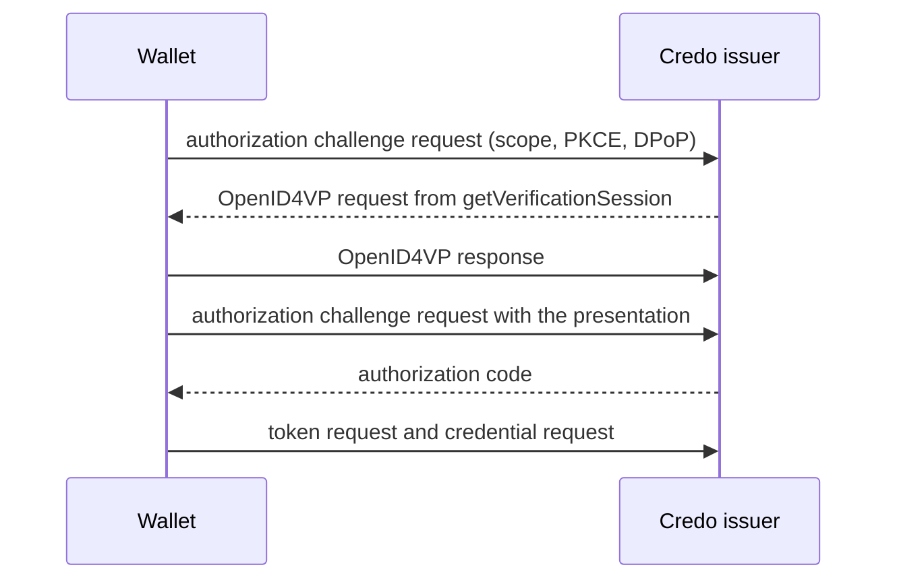

This page covers how an issuer decides who gets a credential beyond the pre-authorized code: the authorization code flow with Credo's built-in authorization server or an external one, and presentation during issuance. It also covers the protections that profiles such as HAIP ask for: PKCE, DPoP, wallet attestations and key attestations. Each section shows the issuer and the holder side. [Issuing credentials](./issuer.mdx) and [Receiving and presenting](./holder.mdx) explain the basics.

## Authorization flows

| Flow | Who authenticates the user | Configure with |
| --- | --- | --- |
| Pre-authorized code | You, before you create the offer | `preAuthorizedCodeFlowConfig`, see [Issuing credentials](./issuer.mdx) |
| Presentation during issuance | Credo, by asking the wallet to present a credential with OpenID4VP | `requirePresentationDuringIssuance` and `getVerificationSession` |
| Chained authorization server | Your identity provider, with Credo's authorization server in between | `authorizationServerConfigs` with `type: 'chained'` |
| External authorization server | Your OAuth 2.0 authorization server, which wallets use directly | `authorizationServerConfigs` with `type: 'direct'` |

The last three use the authorization code flow, and every credential configuration you offer with it needs a `scope`. Credo's built-in authorization server handles the first three. It requires pushed authorization requests (PAR) and supports PKCE, DPoP and wallet attestations.

## Security options

Each protection has a module option that applies to all issuance sessions, and an option per session: in `authorization` when you create an offer, or in the result of `getDynamicIssuanceSession` for wallet-initiated issuance.

| Module option | Per session | Default |
| --- | --- | --- |
| `pkceRequired` | `requirePkce` | `true` |
| `dpopRequired` | `requireDpop` | `false` |
| `walletAttestationsRequired` | `requireWalletAttestation` | `false` |

If you leave the per-session option out, the module option applies. `false` turns the requirement off for that session, even when the module option requires it.

These options apply to Credo's authorization server. An external authorization server enforces its own rules. Credo only checks at the credential endpoint that the access token is bound with DPoP when the offer sets `requireDpop: true`.

## Presentation during issuance

The issuer asks the wallet to present a credential, for example a PID, before it issues a new one. Credo creates the presentation request, verifies the response and only then gives the wallet an authorization code:



### Issuer

The issuer agent also needs the verifier part of the module, and a `getVerificationSession` callback:

```ts showLineNumbers title="issuer.ts" openid4vc-auth.ts section-1
```

The callback creates the OpenID4VP request when a wallet starts the authorization:

```ts showLineNumbers title="issuer.ts" openid4vc-auth.ts section-2
```

- `scopes` are the requested scopes that match the offered credentials. Return the request together with the scopes it grants.
- The request needs a verifier record. Here it uses one with the same id as the issuer.
- `getVerificationSessionForIssuanceSessionAuthorization` is a deprecated name for the same callback.

Create the issuer with a `scope` per credential configuration, and an offer that requires the presentation:

```ts showLineNumbers title="issuer.ts" openid4vc-auth.ts section-4
```

With `requirePresentationDuringIssuance`, `authorizationServerUrl` must be left out (or be the issuer itself), as only Credo's authorization server handles this flow. The mapper receives the verified presentation in `verification`:

```ts showLineNumbers title="issuer.ts" openid4vc-auth.ts section-3
```

### Holder

```ts showLineNumbers title="holder.ts" openid4vc-auth.ts section-5
```

- `resolveOpenId4VciAuthorizationRequest` starts the authorization. `authorizationFlow` tells you whether the issuer wants a presentation or a browser redirect ([below](#holder-redirect-to-the-authorization-server)).
- Present the credential like any other OpenID4VP request. The result has `presentationDuringIssuanceSession`, which proves the presentation to the issuer.
- Pass `codeVerifier` (PKCE) and the `dpop` from the previous call to the token request.

## External authorization servers

### Chained

With a chained authorization server, wallets talk to Credo's authorization server, which sends the user to your identity provider to log in. PAR, PKCE, DPoP and wallet attestations work as with Credo alone:

```ts showLineNumbers title="issuer.ts" openid4vc-auth-external.ts section-2
```

- Credo exchanges the code at your identity provider with `clientAuthentication`. Register `<baseUrl>/<issuerId>/redirect` as the redirect URI of that client.
- `scopesMapping` maps each credential scope to the scopes Credo requests from your identity provider. To decide per session instead, use the `getChainedAuthorizationRequestParameters` callback in the issuer module config.
- `redirectUris` restricts the redirect URIs wallets may use.
- The token response of your identity provider, including an `id_token`, is in `issuanceSession.chainedIdentity.externalAccessTokenResponse` in the mapper.
- A chained flow can't be combined with presentation during issuance.

### Direct

With a direct authorization server, Credo lists it in the issuer metadata, and wallets use it directly:

```ts showLineNumbers title="issuer.ts" openid4vc-auth-external.ts section-1
```

- Your authorization server must link the authorization to the offer through `issuer_state`, and handle PAR, PKCE, DPoP and wallet attestations itself if you need them.
- Credo verifies the access tokens from it at the credential endpoint. `clientAuthentication` is only needed for token introspection.
- For issuance without an offer, where the access token isn't linked to an issuance session, use `getDynamicIssuanceSession`.

### Holder: redirect to the authorization server

With both kinds, the wallet opens the authorization URL in a browser and receives the code on its redirect URI:

```ts showLineNumbers title="holder.ts" openid4vc-auth-external.ts section-3
```

The authorization request goes through PAR when the authorization server supports it. When the server supports PKCE, Credo adds it and returns the `codeVerifier` for the token request.

## PKCE

PKCE ties the authorization code to the wallet that started the authorization. Credo's authorization server requires it by default (`pkceRequired`), and only supports the `S256` method. When a wallet sends a code challenge, Credo always checks the code verifier, also for sessions that don't require PKCE.

On the holder, Credo creates the code challenge when the authorization server supports PKCE, and returns `codeVerifier`. Pass it to `requestToken`.

## DPoP

DPoP binds the access token to a key of the wallet, so nobody else can use a stolen token. Enable it on the issuer record with `dpopSigningAlgValuesSupported` (see the issuer above): Credo only advertises DPoP when it's set. Require it with `dpopRequired` or `requireDpop`. When a wallet uses DPoP in its first request, Credo requires it for the rest of that session.

On the holder, Credo uses DPoP automatically when the authorization server supports it. Each call returns the `dpop` options to use for the next call, as in the examples above. Spreading the token response into `requestCredentials` passes them on.

## Wallet and key attestations

A wallet attestation is a JWT from the wallet provider (the organization behind the wallet app) that says the wallet is a genuine instance of its app. The wallet uses it to authenticate to the authorization server ([OAuth 2.0 Attestation-Based Client Authentication](https://datatracker.ietf.org/doc/draft-ietf-oauth-attestation-based-client-auth/)).

A key attestation lists keys of the wallet and how they're protected, such as in a secure element, with levels from ISO/IEC 18045 (`iso_18045_high`, `iso_18045_moderate`, `iso_18045_enhanced-basic`, `iso_18045_basic`). The issuer can require it before it binds credentials to those keys.

Both come from the wallet provider's backend. Credo doesn't create them.

### Issuer

Trust the wallet provider, for example with `getTrustedIssuersForVerification` in the agent config:

```ts showLineNumbers title="issuer.ts" openid4vc-auth-attestations.ts section-1
```

Then require wallet attestations, and advertise attestation-based client authentication and the key attestation requirements:

```ts showLineNumbers title="issuer.ts" openid4vc-auth-attestations.ts section-2
```

```ts showLineNumbers title="issuer.ts" openid4vc-auth-attestations.ts section-4
```

- `clientAttestationSigningAlgValuesSupported` and `clientAttestationPopSigningAlgValuesSupported` advertise attestation-based client authentication in the authorization server metadata.
- `key_attestations_required` on a proof type requires a key attestation with at least these levels. A higher level satisfies a lower one. Add an `attestation` proof type as well if wallets may send the key attestation as the proof itself.
- By default Credo verifies a wallet attestation whenever a wallet sends one. With `ignoreWalletAttestationsWhenNotRequired`, it ignores attestations for sessions that don't require them. `clientAttestationPopChallengeRequired` makes wallets fetch a challenge for the proof of possession first.
- Trust: Credo checks attestations signed with an X.509 certificate against your trust configuration, and accepts DID-signed attestations unless you return a list of trusted DIDs. It never checks attestations signed with a bare JWK. See [Trusted issuers](../../dids-and-trust/trust.mdx).

The mapper gets the attested keys in `holderBinding.keys`, and the verified key attestation in `holderBinding.keyAttestation`:

```ts showLineNumbers title="issuer.ts" openid4vc-auth-attestations.ts section-3
```

### Holder

```ts showLineNumbers title="holder.ts" openid4vc-auth-attestations.ts section-5
```

- Pass `walletAttestationJwt` to every call to the authorization server: `resolveOpenId4VciAuthorizationRequest`, `retrieveAuthorizationCodeUsingPresentation`, `requestToken` and `refreshToken`. Credo signs the proof of possession with the key in the attestation's `cnf`, so that key must be in the wallet's KMS.
- When the issuer requires key attestations, `proofTypes.jwt.keyAttestationsRequired` (or `proofTypes.attestation`) says so, and the binding resolver must return `{ method: 'attestation', keyAttestationJwt }`. Credential binding to a DID isn't possible then.
- Without a `nonce` in the key attestation, Credo sends a `jwt` proof signed with the first attested key. With the issuer's `cNonce` (passed to the resolver) as `nonce`, it sends the key attestation as an `attestation` proof.
- The attested keys must be in the wallet's KMS. You get one credential instance per attested key.

## Full example

Presentation during issuance with PKCE and DPoP, in one process:

<details>
<summary>openid4vc-auth.ts</summary>

```ts showLineNumbers title="openid4vc-auth.ts" openid4vc-auth.ts
```

</details>

Wallet and key attestations, with a stand-in for the wallet provider:

<details>
<summary>openid4vc-auth-attestations.ts</summary>

```ts showLineNumbers title="openid4vc-auth-attestations.ts" openid4vc-auth-attestations.ts
```

</details>
