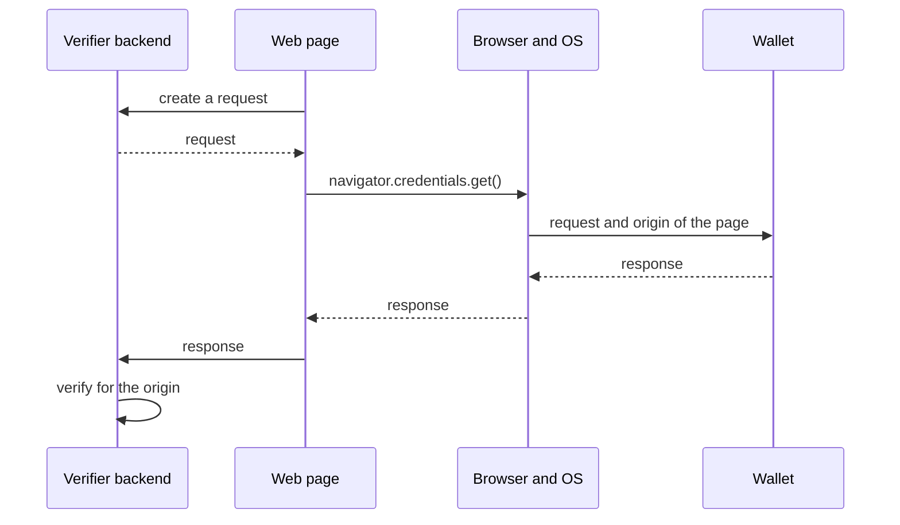

The W3C Digital Credentials API lets a website ask for credentials through the browser. The browser and the operating system let the user pick a wallet, on the same device or on some platforms on a phone nearby, without QR codes or redirects. This page shows a Credo verifier that requests credentials over the API with OpenID4VP, the code for the web page, and the wallet side.

## How it works



The browser tells the wallet the origin of the page that asked. The wallet binds its response to that origin, and the verifier checks it, so a response can't be relayed from another website. Nothing goes over the network between the wallet and the verifier: the response comes back through the page.

Credo creates and verifies the requests and responses on both sides. The browser and the operating system do the rest, and that part is still new. Which browsers support the API, how they reach a wallet, and which protocols they accept differs per platform and changes quickly, so check the current support before you depend on it. A page can pass several requests in one call, and the wallet answers one of them.

The API also carries ISO 18013-7 Annex C (`org-iso-mdoc`) requests for mdocs, and some platforms accept only those. Credo implements that protocol in `agent.mdoc`, without the OpenID4VC module. See [Digital Credentials API (ISO 18013-7)](../mdoc/dc-api.mdx).

## Request credentials with OpenID4VP

### Create the request

The verifier creates an authorization request with a `dc_api` response mode and returns it to the page:

```ts showLineNumbers title="server.ts" openid4vc-dc-api.ts section-1
```

- `responseMode` is `dc_api.jwt` (the response is encrypted to the verifier) or `dc_api` (not encrypted).
- An unsigned request (`method: 'none'`) has no client id. The wallet identifies the verifier by the origin, as `origin:<origin>`. With `version: 'v1.draft24'` it's `web-origin:<origin>`. OpenID4VP draft 21 doesn't support the API.
- Return `authorizationRequestObject` to the page, not the `openid4vp://` URI in `authorizationRequest`.
- `authorizationResponseRedirectUri` doesn't apply, as the response goes back to the page.

To sign the request, use the same `requestSigner` options as for other requests (see [Verifying credentials](./verifier.mdx)), and list the origins of your website:

```ts
requestSigner: { method: 'x5c', x5c: [verifierCertificate] },
expectedOrigins: ['https://verifier.example.com'],
```

### Call the API from the page

```ts showLineNumbers title="page.ts" openid4vc-dc-api-browser.ts section-1
```

```ts showLineNumbers title="page.ts" openid4vc-dc-api-browser.ts section-2
```

- `openid4vp-v1-unsigned` is the protocol for an unsigned OpenID4VP 1.0 request. Use `openid4vp-v1-signed` for a signed request.
- `credential.data` is the wallet's response. Post it to your backend as it is.

### Verify the response

With the `dc_api` response modes, Credo doesn't receive the response at its endpoint. Pass it to `verifyAuthorizationResponse`:

```ts showLineNumbers title="server.ts" openid4vc-dc-api.ts section-2
```

- `origin` is the origin of your page. Use the value you know, not one from the request: verification fails for any other origin.
- The result is the same as for other response modes. See [Verifying credentials](./verifier.mdx) and the format pages for reading the claims.

## Present credentials from a wallet

The wallet app gets the request and the origin of the calling website from the operating system, and gives the response back to it. Registering credentials with the operating system and handling the request there (for example with Credential Manager on Android) is platform code outside Credo. In between, Credo does the work:

```ts showLineNumbers title="wallet.ts" openid4vc-dc-api.ts section-3
```

- Pass the `origin` to both `resolveOpenId4VpAuthorizationRequest` and `acceptOpenId4VpAuthorizationRequest`. The holder rejects a DC API request without it.
- `acceptOpenId4VpAuthorizationRequest` doesn't send anything. It returns `authorizationResponse` for you to hand back to the platform.
- With OpenID4VP 1.0, the key binding JWT of an SD-JWT VC presentation has `origin:<origin>` as audience, also for signed requests.

## Full example

The verifier backend and the wallet in one process. The script plays the part of the page and the browser:

<details>
<summary>openid4vc-dc-api.ts</summary>

```ts showLineNumbers title="openid4vc-dc-api.ts" openid4vc-dc-api.ts
```

</details>

## Next steps

- [Verifying credentials](./verifier.mdx): requests, client identifiers and verification sessions.
- [mdoc with OpenID4VC](./mdoc.mdx) and [SD-JWT VC with OpenID4VC](./sd-jwt-vc.mdx): request and read each format.
- [Digital Credentials API (ISO 18013-7)](../mdoc/dc-api.mdx): request mdocs over the same API with `org-iso-mdoc`.
- [Trusted issuers](../../dids-and-trust/trust.mdx): decide which issuers you trust.
