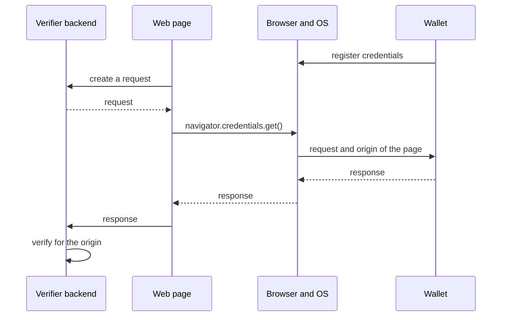

The W3C Digital Credentials API lets a website ask for credentials through the browser. The browser and the operating system let the user pick a wallet, on the same device or on some platforms on a phone nearby, without QR codes or redirects. A flow has three parts, and this page shows each of them with OpenID4VP: the verifier backend, the browser invocation on the verifier's web page, and the wallet.

## How it works



The wallet registers its credentials with the operating system beforehand, so the browser can offer the wallets that hold a matching credential. The browser tells the wallet the origin of the page that asked. The wallet binds its response to that origin, and the verifier checks it, so a response can't be relayed from another website. Nothing goes over the network between the wallet and the verifier: the response comes back through the page.

Credo creates and verifies the requests and responses on both sides. The browser and the operating system do the rest, and that part is still new. Which browsers support the API, how they reach a wallet, and which protocols they accept differs per platform and changes quickly, so check the current support before you depend on it. iOS, for example, only accepts ISO 18013-7 Annex C (`org-iso-mdoc`) requests for mdocs. Credo implements that protocol in `agent.mdoc`, without the OpenID4VC module. See [Digital Credentials API (ISO 18013-7)](../mdoc/dc-api.mdx).

## Verifier backend

The backend is a Node.js server with a Credo agent. It creates the requests, verifies the responses, and serves the web page:

```ts showLineNumbers title="openid4vc-dc-api.ts" openid4vc-dc-api.ts section-1
```

- `origin` is the origin of the page that calls the API. Here the backend serves the page, so it's the backend's own origin.
- The verifier accepts credentials from the issuers in its trust configuration. See [Trusted issuers](../../dids-and-trust/trust.mdx).

### Create the request

The verifier creates an authorization request with a `dc_api` response mode and returns it to the page:

```ts showLineNumbers title="openid4vc-dc-api.ts" openid4vc-dc-api.ts section-2
```

- `responseMode` is `dc_api.jwt` (the response is encrypted to the verifier) or `dc_api` (not encrypted).
- An unsigned request (`method: 'none'`) has no client id. The wallet identifies the verifier by the origin, as `origin:<origin>`. With `version: 'v1.draft24'` it's `web-origin:<origin>`. OpenID4VP draft 21 doesn't support the API.
- Return `authorizationRequestObject` to the page, not the `openid4vp://` URI in `authorizationRequest`.
- `authorizationResponseRedirectUri` doesn't apply, as the response goes back to the page.

To sign the request, use the same `requestSigner` options as for other requests (see [Verifying credentials](./verifier.mdx)), and list the origins of your website:

```ts
requestSigner: { method: 'x5c', x5c: [verifierCertificate] },
expectedOrigins: ['https://verifier.example.com'],
```

### Verify the response

With the `dc_api` response modes, Credo doesn't receive the response at its endpoint. The page posts it to the backend, which passes it to `verifyAuthorizationResponse`:

```ts showLineNumbers title="openid4vc-dc-api.ts" openid4vc-dc-api.ts section-3
```

- `origin` is the origin of your page. Use the value you know, not one from the request: verification fails for any other origin.
- The result is the same as for other response modes. See [Verifying credentials](./verifier.mdx) and the format pages for reading the claims.

## Browser invocation

The web page gets a request from the backend, passes it to `navigator.credentials.get()`, and posts the response back:

```ts showLineNumbers title="openid4vc-dc-api-browser.ts" openid4vc-dc-api-browser.ts section-1
```

- `openid4vp-v1-unsigned` is the protocol for an unsigned OpenID4VP 1.0 request. Use `openid4vp-v1-signed` for a signed request.
- TypeScript's DOM types don't have the `digital` option yet. The full example declares it.
- `credential.data` is the wallet's response. Post it to your backend as it is.
- The call throws a `NotAllowedError` when the user cancels or no wallet has a matching credential. The browser doesn't say which, so a website can't find out what a wallet holds without the user's consent.
- A page can pass several requests in one call, for example also an `org-iso-mdoc` request, so wallets on more platforms can answer. The wallet answers one of them, and `credential.protocol` says which.

Call it when the user clicks a button:

```ts showLineNumbers title="openid4vc-dc-api-browser.ts" openid4vc-dc-api-browser.ts section-2
```

- The browser only opens the wallet shortly after a user action. A single request to your backend before the call is quick enough. For slower work, get the request before the click.
- The API only exists in a secure context (`https`, or `http://localhost`) and in browsers that support it. Elsewhere, fall back to a QR code or a link, see [Verifying credentials](./verifier.mdx).

## Wallet

The operating system passes the request and the origin of the page to the wallet the user picked, through Credential Manager on Android and the Identity Document Services framework on iOS. iOS only passes `org-iso-mdoc` requests. In a React Native wallet, [`@animo-id/expo-digital-credentials-api`](https://github.com/animo/expo-digital-credentials-api) handles the platform side, and Credo creates the response. This section shows a minimal wallet that answers both OpenID4VP and `org-iso-mdoc` requests. The [module README](https://github.com/animo/expo-digital-credentials-api#readme) has all options and platform details.

[Paradym Wallet](https://github.com/animo/paradym-wallet), an open source wallet built on Credo, supports the API this way. See its [request handling](https://github.com/animo/paradym-wallet/blob/main/packages/sdk/src/dcApi/ParadymDcApiSdk.ts), [credential registration](https://github.com/animo/paradym-wallet/blob/main/packages/sdk/src/dcApi/registerCredentials.ts) and [request UI](https://github.com/animo/paradym-wallet/tree/main/apps/wallet/src/features/dc-api) for a complete implementation.

### Set up

<InstallTabs packages="@animo-id/expo-digital-credentials-api expo-secure-store" />

Add the config plugin to `app.json` and run `npx expo prebuild`:

```json title="app.json"
{
  "expo": {
    "plugins": [
      [
        "@animo-id/expo-digital-credentials-api",
        {
          "entry": "src/dc-api-wallet-request",
          "ios": { "documentTypes": ["org.iso.18013.5.1.mDL"] }
        }
      ]
    ]
  }
}
```

- The module needs Expo SDK 55 and React Native 0.83 or later. It works on Android devices with Credential Manager's registry API, and on iOS 26 and later.
- `entry` is the file with the request UI, without extension.
- `ios.documentTypes` are the mdoc document types the wallet can present on iOS, from the set Apple allows. Without it, the plugin doesn't add the iOS app extension.

The app and the request UI open the same wallet:

```ts showLineNumbers title="dc-api-wallet-agent.ts" dc-api-wallet-agent.ts section-1
```

- On iOS, the request UI runs in an app extension, a separate process that can't read the app's files. The config plugin creates an app group, and `getSharedContainerPath()` returns a directory that both can use. A wallet that already has a store elsewhere has to move it there first.
- The plugin also shares the keychain between the app and the extension, so both read the same wallet key.

### Register credentials

The operating system only offers the wallet for a request that matches a registered credential:

```ts showLineNumbers title="dc-api-wallet-agent.ts" dc-api-wallet-agent.ts section-2
```

- On Android, a matcher runs in a sandbox and compares the request with the registered claims. The system picker shows the matching credentials with their values, so register the values: the full example converts them.
- On Android each call replaces the registered set, so pass all credentials.
- iOS only keeps the id and document type of each mdoc and matches on the document type, so a request can reach the wallet for elements the mdoc doesn't have. SD-JWT VCs aren't registered there.

### Answer the request

When the user picks a credential of the wallet, the operating system starts the request UI. Credo resolves the request for the origin and creates the response:

```ts showLineNumbers title="dc-api-wallet-response.ts" dc-api-wallet-response.ts section-1
```

- Pass the `origin` to both `resolveOpenId4VpAuthorizationRequest` and `acceptOpenId4VpAuthorizationRequest`. The holder rejects a DC API request without it.
- `acceptOpenId4VpAuthorizationRequest` doesn't send anything. It returns `authorizationResponse` for you to hand back to the platform.
- `selectCredentialsForDcqlRequest` takes the first matching credential for each query.
- With OpenID4VP 1.0, the key binding JWT of an SD-JWT VC presentation has `origin:<origin>` as audience, also for signed requests.

The request UI calls it when the user shares:

```tsx showLineNumbers title="dc-api-wallet-request.tsx" dc-api-wallet-request.tsx section-1
```

- Always use the origin from the operating system, never one from the request. On Android it's undefined when an app asks for itself instead of a website.
- On Android, `requests` has the requests the page passed, and `selection` the credentials the user picked in the system picker and the request they matched.
- iOS hands over the request only after `approve()`, and only as `org-iso-mdoc`. Show the consent screen from `request.presentmentRequests` before that.
- `respond()` sends the response through the operating system to the page, `decline()` cancels. Until then the request stays open, so the user can try again after an error.

The entry file registers the screen:

```tsx title="dc-api-wallet-request.tsx" dc-api-wallet-request.tsx section-2
```

The request UI is bundled separately from the app. Import only what it needs: on iOS the extension gets little memory.

## Full example

The verifier backend serves the page from `public/`. Put the certificate of the issuer you trust in `issuer-certificate.pem`, then start it with `npx tsx openid4vc-dc-api.ts` and open `http://localhost:4037`.

<Tabs>
<TabItem value="backend" label="Verifier backend">

```ts showLineNumbers title="openid4vc-dc-api.ts" openid4vc-dc-api.ts
```

</TabItem>
<TabItem value="browser" label="Browser invocation">

Compile the script into `public/`, for example with `npx esbuild openid4vc-dc-api-browser.ts --outdir=public`.

```html title="public/index.html"
<button>Verify with your wallet</button>
<script type="module" src="openid4vc-dc-api-browser.js"></script>
```

```ts showLineNumbers title="openid4vc-dc-api-browser.ts" openid4vc-dc-api-browser.ts
```

</TabItem>
<TabItem value="wallet" label="Wallet">

```ts showLineNumbers title="dc-api-wallet-agent.ts" dc-api-wallet-agent.ts
```

```ts showLineNumbers title="dc-api-wallet-response.ts" dc-api-wallet-response.ts
```

```tsx showLineNumbers title="dc-api-wallet-request.tsx" dc-api-wallet-request.tsx
```

</TabItem>
</Tabs>

## Next steps

- [Verifying credentials](./verifier.mdx): requests, client identifiers and verification sessions.
- [mdoc with OpenID4VC](./mdoc.mdx) and [SD-JWT VC with OpenID4VC](./sd-jwt-vc.mdx): request and read each format.
- [Digital Credentials API (ISO 18013-7)](../mdoc/dc-api.mdx): request mdocs over the same API with `org-iso-mdoc`.
- [Trusted issuers](../../dids-and-trust/trust.mdx): decide which issuers you trust.
