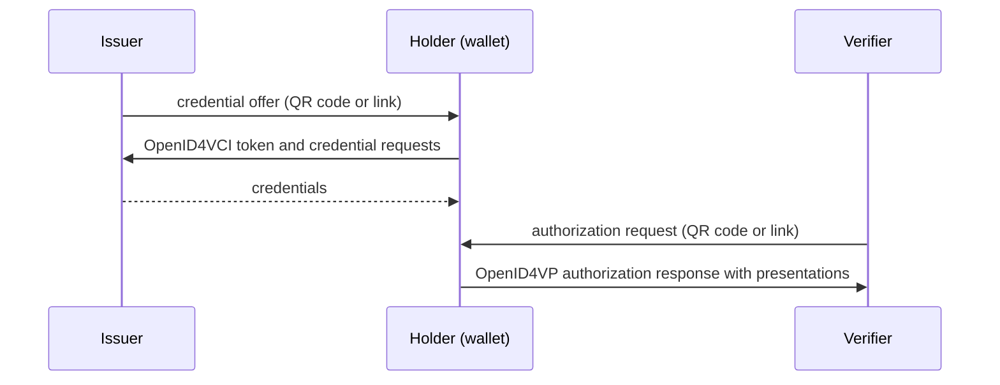

OpenID for Verifiable Credentials (OpenID4VC) is a family of protocols, built on OAuth 2.0, for issuing and presenting credentials over HTTPS. This page explains the protocols and roles, and how to set up the `@credo-ts/openid4vc` module. The pages below it cover each role.

## Protocols

| Specification | What it covers |
| --- | --- |
| OpenID4VCI | Issuance. A wallet gets credentials from an issuer. The issuer authorizes it with a pre-authorized code in the offer, or with the OAuth authorization code flow. |
| OpenID4VP | Presentation. A verifier sends an authorization request with a DCQL query, and the wallet responds with presentations of matching credentials. |
| HAIP | The High Assurance Interoperability Profile of both protocols, used by ecosystems such as the EU Digital Identity Wallet. It fixes choices such as SD-JWT VC and mdoc as formats, X.509-signed requests, encrypted responses, and DPoP and wallet attestations for issuance. |

There is no connection between the parties. Each exchange is a separate session, started by a credential offer or an authorization request that the wallet receives as a QR code or link.



[Supported standards](../../supported-standards.mdx) lists the versions and drafts Credo supports, and which credential formats work with each protocol.

## Roles

| Role | API | Platform |
| --- | --- | --- |
| Issuer | `agent.openid4vc.issuer` | Node.js |
| Verifier | `agent.openid4vc.verifier` | Node.js |
| Holder | `agent.openid4vc.holder` | Node.js and React Native |

Issuers and verifiers serve HTTP endpoints with Express, so they run on Node.js. On React Native only the holder is available.

## Install

<InstallTabs packages="@credo-ts/openid4vc" />

For an issuer or verifier, also install Express 5:

<InstallTabs packages="express@^5" />
<InstallTabs packages="@types/express@^5" dev />

## Configure the module

An agent that issues and verifies credentials:

```ts showLineNumbers title="agent.ts" openid4vc-setup.ts section-1
```

- Register the module under the key `openid4vc`, so it's available as `agent.openid4vc`. Under any other key it's only available through `agent.modules`.
- `issuer` and `verifier` are optional and turn on that role. The holder is always available.
- `baseUrl` is the public URL of the endpoints. Credo serves them under its path (`/oid4vci` and `/oid4vp` here). The issuer metadata is also served at `/.well-known/openid-credential-issuer/oid4vci/<issuerId>` on the root of the host, as OpenID4VCI requires, so the app must receive requests for the whole host.
- `credentialRequestToCredentialMapper` goes directly in `issuer`. `endpoints` only changes the paths of the endpoints. See [Issuing credentials](./issuer.mdx).
- `app` is your Express app. If you leave it out, Credo creates one, available as `agent.openid4vc.config.app`. Either way, you start the server. Credo adds its routes during `agent.initialize()`, so add your own middleware and routes after that.

The issuer and verifier support [multi-tenancy](../../agent-setup/multi-tenancy.mdx): Credo finds the tenant from the issuer or verifier id in the URL. Options for authorization, such as `dpopRequired`, `pkceRequired` and `walletAttestationsRequired`, are explained in [Authorization and wallet security](./authorization.mdx).

A holder needs no options:

```ts
openid4vc: new OpenId4VcModule(),
```

For local development over `http://localhost`, set `allowInsecureHttpUrls: true` in the agent config of all parties. Never enable it in production.

## The example flow

The pages for each role build one example: an issuer that issues an employee badge as an SD-JWT VC with the pre-authorized code flow, a holder that receives and presents it, and a verifier that requests two of its claims. This runs them in one process:

```ts showLineNumbers title="flow.ts" protocols-openid4vc-flow.ts section-1
```

<DocCardList />
