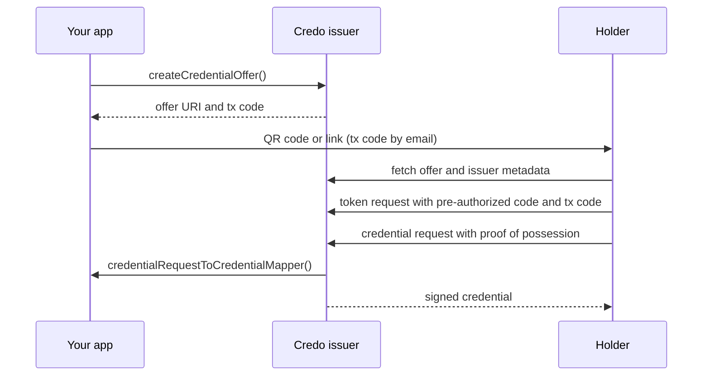

This page covers issuing credentials with OpenID4VCI from a Node.js agent: the issuer metadata, the callback that creates each credential, and credential offers with the pre-authorized code flow. The examples issue an SD-JWT VC.

## How issuance works



Your application decides who gets which credential and creates the offer. Credo hosts the OpenID4VCI endpoints, checks the holder's requests and signs the credentials your callback returns.

## Choose a credential format

| Format | Use when |
| --- | --- |
| [SD-JWT VC](./sd-jwt-vc.mdx) | By default. JSON claims with selective disclosure, required by HAIP and used for the EU PID. |
| [mdoc](./mdoc.mdx) | The credential follows an ISO document type, such as the mobile driving licence, or holders must also present it in person over BLE or NFC. |
| [W3C VC](./w3c.mdx) | Your ecosystem requires the W3C data model. Use `jwt_vc_json` or VCDM 2.0 with SD-JWT. |

You can offer the same credential in several formats, each as its own credential configuration. The format pages cover the configuration and signing for each.

## Set up the issuer

Register `OpenId4VcModule` with an `issuer` configuration. [OpenID4VC](./index.mdx) explains the module options.

```ts showLineNumbers title="issuer.ts" openid4vc-issuer.ts section-1
```

`baseUrl` is the public URL of the issuer endpoints. Each issuer you create gets the credential issuer identifier `<baseUrl>/<issuerId>`. `credentialRequestToCredentialMapper` creates the credentials when a holder requests them, see [Create the credentials](#create-the-credentials).

## Create a signing key and certificate

The issuer signs credentials with a key from the agent's KMS. For SD-JWT VC and mdoc it includes an X.509 certificate for that key, so holders and verifiers can check who signed.

```ts showLineNumbers title="issuer.ts" openid4vc-issuer.ts section-2
```

The example uses a self-signed certificate. In production a certificate authority issues it, and holders and verifiers trust that CA. See [X.509 certificates](../../dids-and-trust/x509.mdx). If you load a certificate instead of creating it, set `certificate.keyId` to the KMS key id of its key so Credo can sign with it. To sign with a DID instead, use `issuer: { method: 'did', didUrl }` in the callback.

## Create the issuer

An issuer record holds the metadata that holders fetch from `/.well-known/openid-credential-issuer`: the issuer's display name and the credentials it offers. One agent can host several issuers.

```ts showLineNumbers title="issuer.ts" openid4vc-issuer.ts section-3
```

Each key of `credentialConfigurationsSupported` is a credential configuration id. You use these ids when you create offers. For each configuration:

- Set `proof_types_supported`. Credo only issues credentials bound to a holder key, so it always asks for a proof of possession, and a Credo holder rejects configurations without this field.
- Put display information under `credential_metadata`, as OpenID4VCI 1.0 defines. Wallets that implement draft 15 read `display` and `claims` at the top level of the configuration, so add them there as well if you need to support those wallets.

Create the issuer once, for example when you deploy, and keep its `issuerId`. Credo generates a UUID unless you pass one. Change the metadata later with `updateIssuerMetadata`.

For batch issuance, set `batchCredentialIssuance: { batchSize }` on the issuer. A holder can then request up to that many instances of a credential in one request, each bound to a different key, so verifiers can't link its presentations to each other.

## Create the credentials

Credo checks each credential request (the access token and the holder's proof of possession of its keys) and then calls your `credentialRequestToCredentialMapper` with, among others:

- `issuanceSession`: the session created with the offer, including the `issuanceMetadata` you passed.
- `credentialConfigurationId` and `credentialConfiguration`: the configuration the holder requests.
- `holderBinding`: the verified keys or DIDs to bind the credentials to.

```ts showLineNumbers title="issuer.ts" openid4vc-issuer.ts section-4
```

Return exactly one credential for each entry in `holderBinding.keys`. With batch issuance there are several entries, and Credo rejects the result if the counts differ. The `format` you return decides how Credo signs: `ClaimFormat.SdJwtDc` for SD-JWT VC, `ClaimFormat.MsoMdoc` for mdoc, or one of the W3C formats. To issue the credential later, return a deferral instead (see [Deferred issuance](#deferred-issuance)).

## Create a credential offer

An offer tells the holder which credentials it can get and how to get authorization. Pick the flow:

- **Pre-authorized code** (this page): your application has already identified the user, for example after a login on your website, and the offer itself carries the authorization. Use it by default.
- **Authorization code**: the holder sends the user to an authorization server to log in, or presents a credential such as a PID first. Use it when the user isn't known yet, or when your ecosystem follows HAIP. See [Authorization and wallet security](./authorization.mdx).

```ts showLineNumbers title="issuer.ts" openid4vc-issuer.ts section-5
```

`credentialOffer` is a URI such as `openid-credential-offer://?credential_offer_uri=...`. Show it as a QR code when the wallet runs on another device, or as a link on the same device. `baseUri` changes the `openid-credential-offer://` prefix, for example to a custom scheme or an HTTPS link.

`txCode` makes the wallet ask the user for a transaction code. Credo generates the code and stores it as `issuanceSession.userPin` (4 digits unless you set `length`). Send it over a different channel than the offer, such as email or SMS, so that someone who intercepts the offer can't redeem it.

The holder must finish the whole issuance before the offer expires: 3 minutes by default. Change it per offer with `expirationInSeconds`, or for all offers with `statefulCredentialOfferExpirationInSeconds` in the issuer configuration.

## Track issuance sessions

Each offer creates an issuance session. Listen for state changes to update your application:

```ts showLineNumbers title="issuer.ts" openid4vc-issuer.ts section-6
```

In the pre-authorized code flow a session goes through `OfferCreated`, `OfferUriRetrieved`, `AccessTokenRequested`, `AccessTokenCreated`, `CredentialRequestReceived` and `Completed`. Other states:

| State | When |
| --- | --- |
| `AuthorizationInitiated`, `AuthorizationGranted` | Authorization code flow with Credo as the authorization server. |
| `CredentialsPartiallyIssued` | The offer has several credential configurations and the holder hasn't requested all of them yet. |
| `Error` | The session failed or expired. `errorMessage` says why. |

To read a session at any time, call `agent.openid4vc.issuer.getIssuanceSessionById(id)`.

## Deferred issuance

If a credential isn't ready when the holder asks for it, for example because it needs manual approval, return `{ type: 'deferral', transactionId, interval }` from the mapper. The holder retries at the deferred credential endpoint after `interval` seconds. Credo then calls `deferredCredentialRequestToCredentialMapper` from the issuer configuration, which returns the credentials or another deferral. The session stays valid for `interval` plus `deferralIntervalGracePeriodInSeconds` (7 days by default).

## Next steps

- [Receiving credentials](./receive.mdx): the holder side of this flow.
- [SD-JWT VC with OpenID4VC](./sd-jwt-vc.mdx): claims, selective disclosure and type metadata.
- [Authorization and wallet security](./authorization.mdx): the authorization code flow, PKCE, DPoP and wallet attestations.
