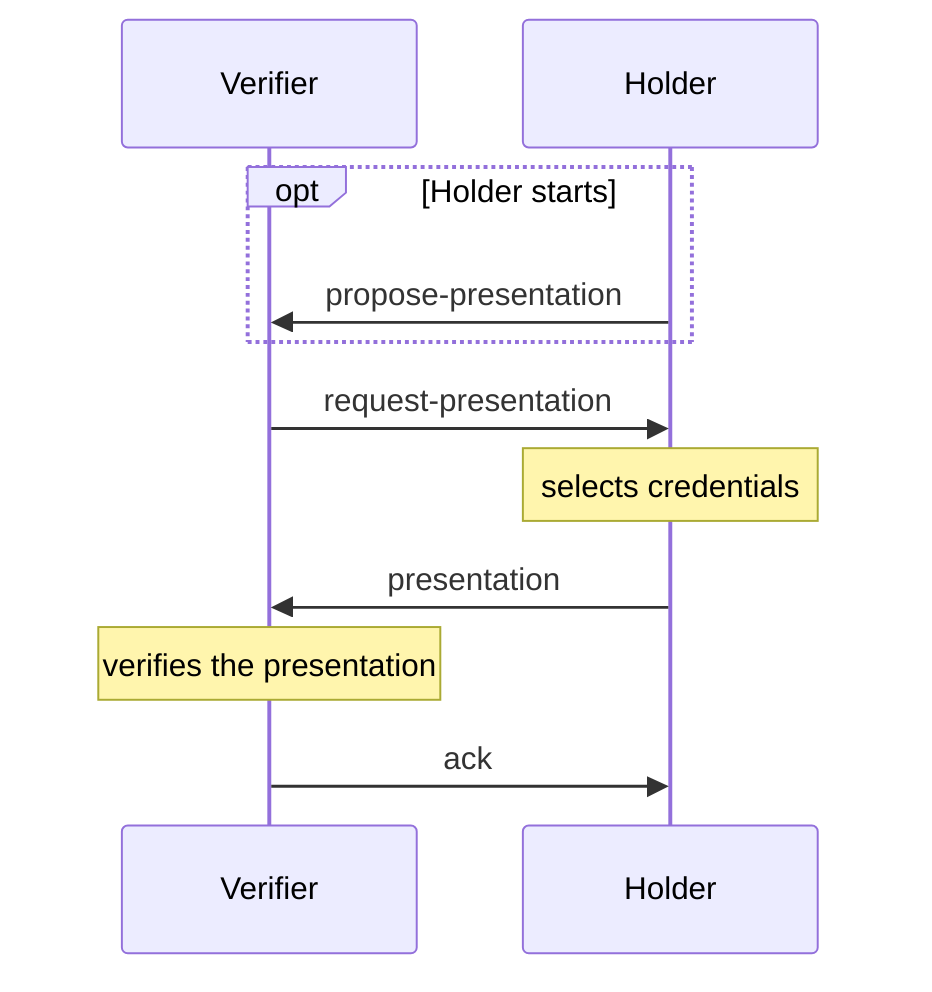

Present Proof v2 ([Aries RFC 0454](https://github.com/decentralized-identity/aries-rfcs/tree/main/features/0454-present-proof-v2)) lets a verifier request a presentation from a connected holder and verify it. Like issuance, the protocol relies on format services for the request and presentation. This page shows the protocol with DIF Presentation Exchange and a W3C JSON-LD credential. You need an agent with the DIDComm module and a connection, see [DIDComm](./index.mdx) and [Connections](./connections.mdx).

## Register proof formats

The proofs module that `DidCommModule` enables by default runs Present Proof v2 without formats. Pass a `DidCommProofV2Protocol` with the format services you need, on both the verifier and the holder.

```ts showLineNumbers title="agent.ts" didcomm-proof.ts section-1
```

| Format | Format service | Import from | Key | Presents |
| --- | --- | --- | --- | --- |
| AnonCreds | `AnonCredsDidCommProofFormatService` | `@credo-ts/anoncreds/didcomm` | `anoncreds` | AnonCreds credentials |
| AnonCreds with Hyperledger Indy attachments | `LegacyIndyDidCommProofFormatService` | `@credo-ts/anoncreds/didcomm` | `indy` | AnonCreds credentials |
| DIF Presentation Exchange ([RFC 0510](https://github.com/decentralized-identity/aries-rfcs/tree/main/features/0510-dif-pres-exch-attach)) | `DidCommDifPresentationExchangeProofFormatService` | `@credo-ts/didcomm` | `presentationExchange` | W3C VCDM 1.1 credentials as JSON-LD (`ldp_vp`) or JWT (`jwt_vp`) presentations, and AnonCreds credentials issued in W3C format |

Use `anoncreds` for AnonCreds credentials and `presentationExchange` for W3C credentials. Present Proof doesn't support SD-JWT VC, mdoc or W3C VCDM 2.0 credentials, including the VCDM 2.0 credentials you can receive over DIDComm. Present SD-JWT VC, mdoc and VCDM 2.0 SD-JWT credentials with [OpenID4VC](../openid4vc/index.mdx) instead.

The Presentation Exchange format uses version 1 presentation definitions, which need a `schema` on each input descriptor.

## How a presentation works



The verifier usually starts with a request. The holder can also propose what it wants to share with `proposeProof`, and the verifier answers with `acceptProposal`. Both sides track the exchange in a `DidCommProofExchangeRecord`.

## Request a proof

:::verifier

```ts showLineNumbers title="verifier.ts" didcomm-proof.ts section-2
```

:::

Credo looks up candidate credentials by the `schema` URI, which matches a JSON-LD context or an expanded type of the credential. The `constraints` then filter on the credential's content with JSONPath and JSON Schema. Credo adds a random challenge to the request, which the holder signs, unless you set `options.challenge` yourself.

To request a proof without a connection, create it with `createRequest` and attach the returned `message` to an out-of-band invitation, with `handshake: false` to skip creating a connection.

## Respond to a request

:::holder

```ts showLineNumbers title="holder.ts" didcomm-proof.ts section-3
```

:::

`selectCredentialsForRequest` picks the first matching credential for each requested item and throws if something can't be satisfied. To let the user choose, call `getCredentialsForRequest`, which lists all candidates per item, and pass the chosen credentials in `proofFormats` to `acceptRequest`. `declineRequest` rejects the request.

The holder signs a JSON-LD or JWT presentation with an `authentication` key of the DID in `credentialSubject.id`, so that DID must be one the holder created in its agent.

## Check the result

The verifier verifies the presentation as soon as it arrives. A valid presentation moves the exchange to `PresentationReceived` with `isVerified: true`. An invalid one moves it to `Abandoned`, sets `errorMessage` and sends a problem report to the holder.

:::verifier

```ts showLineNumbers title="verifier.ts" didcomm-proof.ts section-4
```

:::

Verification covers the signatures, the challenge, holder binding and whether the presentation satisfies the request. Which issuers you trust is up to you: restrict them in the request (for AnonCreds with `restrictions`), configure [trusted issuers](../../dids-and-trust/trust.mdx) for W3C credentials, or check the issuer in the format data.

`acceptPresentation` sends the ack and completes the exchange. With `ContentApproved` auto-accept, Credo sends the ack for you, so leave that call out.

## Auto-accept

Set `autoAcceptProofs` on the proofs module, or `autoAcceptProof` on a single API call.

| `DidCommAutoAcceptProof` | Behaviour |
| --- | --- |
| `Never` (default) | Every step needs an API call: `acceptRequest`, `acceptPresentation`, and so on. |
| `ContentApproved` | The holder answers a request automatically only when it matches the holder's own proposal. The verifier acknowledges valid presentations automatically. |
| `Always` | The holder answers every request with automatically selected credentials, without asking the user. |

The verifier only acknowledges automatically when the request had `willConfirm` set, which is the default.

For a verifier, `ContentApproved` saves the `acceptPresentation` call. For a wallet, use `ContentApproved` or `Never`, so the user approves each request. `Always` shares credentials without asking the user.

## States and events

Listen to `DidCommProofEventTypes.ProofStateChanged`. The payload has the `proofRecord` and its `previousState`.

| `DidCommProofState` | Agent | Next step |
| --- | --- | --- |
| `ProposalSent` | holder | wait for the request |
| `ProposalReceived` | verifier | `acceptProposal` or `negotiateProposal` |
| `RequestSent` | verifier | wait for the presentation |
| `RequestReceived` | holder | `acceptRequest`, `declineRequest` or `negotiateRequest` |
| `PresentationSent` | holder | wait for the ack |
| `PresentationReceived` | verifier | the presentation is valid, `acceptPresentation` sends the ack |
| `Done` | both | |
| `Declined` | holder | |
| `Abandoned` | both | the exchange failed, `errorMessage` says why |

`agent.didcomm.proofs.getFormatData(proofRecordId)` returns the proposal, request and presentation per format.

## Present Proof v1

:::warning[Deprecated]

Present Proof v1 ([Aries RFC 0037](https://github.com/decentralized-identity/aries-rfcs/tree/main/features/0037-present-proof)) is deprecated and removed in Credo 0.8. Use v2 unless the other agent only supports v1.

:::

Present Proof v1 only carries AnonCreds proofs in the `indy` format. Register it next to v2, and pass `protocolVersion: 'v1'` in the API calls:

```ts
import { DidCommProofV1Protocol, LegacyIndyDidCommProofFormatService } from '@credo-ts/anoncreds/didcomm'

const proofProtocol = new DidCommProofV1Protocol({
  indyProofFormat: new LegacyIndyDidCommProofFormatService(),
})
```
