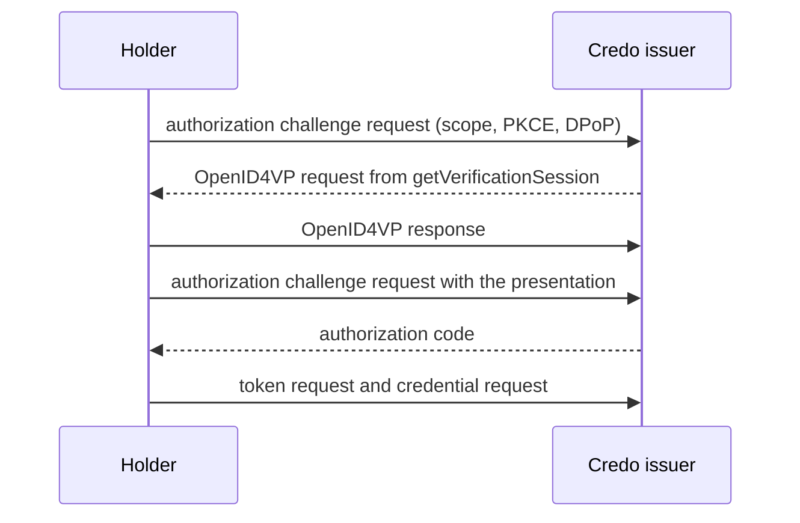

This page is about issuance (OpenID4VCI): how an issuer decides who gets a credential beyond the pre-authorized code, and the protections that profiles such as HAIP ask for when a wallet requests credentials: PKCE, DPoP, wallet attestations and key attestations. Each section has an issuer part and a holder part. For the verifier side of security, such as signed requests and encrypted responses, see [Verifying credentials](./verifier.mdx). [Issuing credentials](./issuer.mdx) and [Receiving credentials](./receive.mdx) explain the basics.

## Choose an authorization flow

| Flow | Who authenticates the user | Use when | Configure with |
| --- | --- | --- | --- |
| Pre-authorized code | Your application, before it creates the offer | You already know the user, for example after a login on your website. | `preAuthorizedCodeFlowConfig`, see [Issuing credentials](./issuer.mdx) |
| Presentation during issuance | Credo, which asks the holder to present a credential with OpenID4VP | The user proves who they are with a credential they already have, such as a PID. | `requirePresentationDuringIssuance` and `getVerificationSession` |
| Chained authorization server | Your identity provider, with Credo's authorization server in between | Users log in with your existing OpenID Connect provider. | `authorizationServerConfigs` with `type: 'chained'` |
| External authorization server | Your OAuth 2.0 authorization server, which holders use directly | You run an authorization server that already supports OpenID4VCI. | `authorizationServerConfigs` with `type: 'direct'` |

Start with the pre-authorized code. HAIP requires the authorization code flow, which the other three use. When users have to log in, prefer a chained authorization server over an external one: Credo's authorization server then still handles PAR, PKCE, DPoP and wallet attestations, which an external server has to implement itself.

Every credential configuration you offer with the authorization code flow needs a `scope`. Credo's built-in authorization server handles the first three flows, and requires pushed authorization requests (PAR).

## Security features

| Feature | Protects against | HAIP | Credo issuer default |
| --- | --- | --- | --- |
| PKCE | Another app redeeming an intercepted authorization code | Required, with `S256` | Off |
| DPoP | Someone else using a stolen access token. DPoP binds the token to a key of the holder. | Required | Off |
| Wallet attestation | Wallet apps you don't trust getting credentials. The wallet authenticates with an attestation from its wallet provider. | Issuers must authenticate wallets, usually with wallet attestations | Off |
| Key attestation | Credentials bound to keys without the protection you need, for example outside a secure element | Wallets must support them | Off, set per credential configuration |

For an issuer: turn on PKCE and DPoP. Require wallet and key attestations only when the wallets you issue to get them from their wallet provider, as in the EU Digital Identity Wallet ecosystem. Wallets without them can't get your credentials.

For a wallet: the Credo holder uses PKCE and DPoP automatically when the issuer supports them. Wallet and key attestations need a backend from your wallet provider, see [Wallet and key attestations](#wallet-and-key-attestations).

### Module and session options

Each requirement has a module option that applies to all issuance sessions, and an option per session: in `authorization` when you create an offer, or in the result of `getDynamicIssuanceSession` for wallet-initiated issuance.

| Module option | Per session | Default |
| --- | --- | --- |
| `pkceRequired` | `requirePkce` | `false` |
| `dpopRequired` | `requireDpop` | `false` |
| `walletAttestationsRequired` | `requireWalletAttestation` | `false` |

If you leave the per-session option out, the module option applies. `requirePkce: false` turns PKCE off for that session, even when the module option requires it. `requireDpop: false` and `requireWalletAttestation: false` fall back to the module option, so you can't turn a requirement of the module off for one session.

These options apply to Credo's authorization server. An external authorization server enforces its own rules. Credo only checks at the credential endpoint that the access token is bound with DPoP when the offer sets `requireDpop: true`.

## Presentation during issuance

The issuer asks the holder to present a credential, for example a PID, before it issues a new one. Credo creates the presentation request, verifies the response and only then gives the holder an authorization code:



### Issuer

The issuer agent also needs the verifier part of the module, and a `getVerificationSession` callback:

:::issuer

```ts showLineNumbers title="issuer.ts" openid4vc-auth.ts section-1
```

:::

The callback creates the OpenID4VP request when a holder starts the authorization. `scopes` are the requested scopes that match the offered credentials. Return the request together with the scopes it grants. The request needs a verifier record, here one with the same id as the issuer:

:::issuer

```ts showLineNumbers title="issuer.ts" openid4vc-auth.ts section-2
```

:::

Create the issuer with a `scope` per credential configuration, and an offer that requires the presentation. Leave `authorizationServerUrl` out (or set it to the issuer itself), as only Credo's authorization server handles this flow:

:::issuer

```ts showLineNumbers title="issuer.ts" openid4vc-auth.ts section-4
```

:::

The mapper receives the verified presentation in `verification`:

:::issuer

```ts showLineNumbers title="issuer.ts" openid4vc-auth.ts section-3
```

:::

### Holder

:::holder

```ts showLineNumbers title="holder.ts" openid4vc-auth.ts section-5
```

:::

`resolveOpenId4VciAuthorizationRequest` starts the authorization. `authorizationFlow` tells you whether the issuer wants a presentation or a browser redirect ([below](#external-authorization-servers)). Present the credential like any other OpenID4VP request: the result has `presentationDuringIssuanceSession`, which proves the presentation to the issuer. Pass `codeVerifier` (PKCE) and the `dpop` from the previous call to the token request.

## External authorization servers

### Issuer: chained

With a chained authorization server, holders talk to Credo's authorization server, which sends the user to your identity provider to log in. PAR, PKCE, DPoP and wallet attestations work as with Credo alone:

:::issuer

```ts showLineNumbers title="issuer.ts" openid4vc-auth-external.ts section-2
```

:::

- Credo exchanges the code at your identity provider with `clientAuthentication`. Register `<baseUrl>/<issuerId>/redirect` as the redirect URI of that client.
- `scopesMapping` maps each credential scope to the scopes Credo requests from your identity provider. To decide per session instead, use the `getChainedAuthorizationRequestParameters` callback in the issuer module config.
- Set `redirectUris` to the redirect URIs of the wallets you accept. Without it, Credo accepts any redirect URI.

In the mapper, the token response of your identity provider, including an `id_token`, is in `issuanceSession.chainedIdentity.externalAccessTokenResponse`. A chained flow can't be combined with presentation during issuance.

### Issuer: direct

With a direct authorization server, Credo lists it in the issuer metadata, and holders use it directly:

:::issuer

```ts showLineNumbers title="issuer.ts" openid4vc-auth-external.ts section-1
```

:::

Your authorization server must link the authorization to the offer through `issuer_state`, and handle PAR, PKCE, DPoP and wallet attestations itself if you need them. Credo verifies its access tokens at the credential endpoint, and only needs `clientAuthentication` for token introspection. For issuance without an offer, where the access token isn't linked to an issuance session, use `getDynamicIssuanceSession`.

### Holder

With both kinds, the holder opens the authorization URL in a browser and receives the code on its redirect URI:

:::holder

```ts showLineNumbers title="holder.ts" openid4vc-auth-external.ts section-3
```

:::

The authorization request goes through PAR when the authorization server supports it. When the server supports PKCE, Credo adds it and returns the `codeVerifier` for the token request.

## PKCE and DPoP

### Issuer

PKCE ties the authorization code to the holder that started the authorization. Credo's authorization server doesn't require it by default. Turn it on with `pkceRequired: true`, as in the [full example](#full-example). Credo only supports the `S256` method. When a holder sends a code challenge, Credo always checks the code verifier, also for sessions that don't require PKCE.

DPoP binds the access token to a key of the holder. Enable it on the issuer record with `dpopSigningAlgValuesSupported`, as in the [presentation during issuance](#presentation-during-issuance) example: Credo only advertises DPoP when it's set. Require it with `dpopRequired` or `requireDpop`. When a holder uses DPoP in its first request, Credo requires it for the rest of that session.

### Holder

Credo creates the PKCE code challenge when the authorization server supports PKCE, and returns `codeVerifier`. Pass it to `requestToken`. Credo uses DPoP when the authorization server supports it. Each call returns the `dpop` options for the next call, as in the examples above. Spreading the token response into `requestCredentials` passes them on.

## Wallet and key attestations

A wallet attestation is a JWT from the wallet provider (the organization behind the wallet app) that says the wallet is a genuine instance of its app. The wallet uses it to authenticate to the authorization server ([OAuth 2.0 Attestation-Based Client Authentication](https://datatracker.ietf.org/doc/draft-ietf-oauth-attestation-based-client-auth/)).

A key attestation lists keys of the wallet and how they're protected, such as in a secure element, with levels from ISO/IEC 18045 (`iso_18045_high`, `iso_18045_moderate`, `iso_18045_enhanced-basic`, `iso_18045_basic`). The issuer can require it before it binds credentials to those keys.

Both come from the wallet provider's backend. Credo doesn't create them.

### Issuer

Trust the wallet provider, for example with `getTrustedIssuersForVerification` in the agent config:

:::issuer

```ts showLineNumbers title="issuer.ts" openid4vc-auth-attestations.ts section-1
```

:::

Credo checks attestations signed with an X.509 certificate against your trust configuration, and accepts DID-signed attestations unless you return a list of trusted DIDs. See [Trusted issuers](../../dids-and-trust/trust.mdx).

:::warning

Your trust configuration only applies to attestations signed with an `x5c` certificate chain or a DID. Credo accepts an attestation signed with a bare JWK (a `jwk` header) from anyone whose signature verifies, so it proves nothing about the wallet provider.

:::

Then require wallet attestations, advertise attestation-based client authentication (`clientAttestationSigningAlgValuesSupported` and `clientAttestationPopSigningAlgValuesSupported`), and set the key attestation requirements:

:::issuer

```ts showLineNumbers title="issuer.ts" openid4vc-auth-attestations.ts section-2
```

```ts showLineNumbers title="issuer.ts" openid4vc-auth-attestations.ts section-4
```

:::

`key_attestations_required` on a proof type requires a key attestation with at least these levels. A higher level satisfies a lower one. Add an `attestation` proof type as well if wallets may send the key attestation as the proof itself.

By default Credo verifies a wallet attestation whenever a wallet sends one, and then requires it for the rest of the session. `ignoreWalletAttestationsWhenNotRequired` ignores attestations for sessions that don't require them. `clientAttestationPopChallengeRequired` makes wallets fetch a challenge for the proof of possession first.

The mapper gets the attested keys in `holderBinding.keys`, and the verified key attestation in `holderBinding.keyAttestation`:

:::issuer

```ts showLineNumbers title="issuer.ts" openid4vc-auth-attestations.ts section-3
```

:::

### Holder

:::holder

```ts showLineNumbers title="holder.ts" openid4vc-auth-attestations.ts section-5
```

:::

Pass `walletAttestationJwt` to every call to the authorization server: `resolveOpenId4VciAuthorizationRequest`, `retrieveAuthorizationCodeUsingPresentation`, `requestToken` and `refreshToken`. Credo signs the proof of possession with the key in the attestation's `cnf`, so that key must be in the wallet's KMS.

When the issuer requires key attestations, `proofTypes.jwt.keyAttestationsRequired` (or `proofTypes.attestation`) says so, and the binding resolver must return `{ method: 'attestation', keyAttestationJwt }`. Binding to a DID isn't possible then. The attested keys must be in the wallet's KMS, with their KMS key id as `kid`, and you get one credential instance per attested key. Without a `nonce` in the key attestation, Credo sends a `jwt` proof signed with the first attested key. With the issuer's `cNonce` (passed to the resolver) as `nonce`, it sends the key attestation as an `attestation` proof.

## Full example

Presentation during issuance with PKCE and DPoP, in one process:

<details>
<summary>openid4vc-auth.ts</summary>

```ts showLineNumbers title="openid4vc-auth.ts" openid4vc-auth.ts
```

</details>

Wallet and key attestations, with a stand-in for the wallet provider:

<details>
<summary>openid4vc-auth-attestations.ts</summary>

```ts showLineNumbers title="openid4vc-auth-attestations.ts" openid4vc-auth-attestations.ts
```

</details>
